# 1. 产品介绍

## 1.1 产品安全

1\. 本产品内含排针针脚，小心排针刺伤，请勿让7岁以下的儿童接触，放在他们拿不到的地方。

2\. 本产品包含导电部件(控制板和电子模块），请按照本教程的要求进行操作，不当的操作可能导致过热并且损害零件，请勿触摸并立即断开电路电源。

## 1.2 产品简介

本款是面向 STEAM 机器人教育的 DIY 开源机械手臂，以ESP32作为主控单元，搭载 4 路舵机，实现底座左右旋转、手臂抬起与放下、手臂前伸与后缩、夹爪开与合 等 4 组自由度动作，可完成物件抓取、搬运等模拟作业。

套装包含机械手臂结构件、ESP32 主控板、摇杆模块、舵机、舵机扩展板、线材、配件等；提供完整开源代码，支持二次开发学习。

适合机器人入门学习、Arduino/ESP32 编程实训、课程设计、DIY 创作，帮助学习者理解 PWM 舵机驱动、无线通信、多关节联动控制原理。

⚠️ **供电提示：舵机工作电流较大，务必给扩展板 接入 7‑12V 直流电源，不可直接依靠主控板 USB 供电，避免舵机抖动、主控板重启。**

## 1.3 产品特点

**灵活性：** 机械手臂具有4个自由度，可以在多个方向上移动和旋转，能够执行各种复杂的动作和任务。

**控制方便：** 采用ESP32微控制器作为控制核心，具有丰富的接口和通信功能，方便与其他设备或系统进行通信和控制。

**编程灵活性：** 通过编程控制，可以实现机械手臂的自动化操作，例如运动轨迹规划、物体抓取和放置等功能。

**模块化组装设计：** 散件 DIY 拼装，可动手完成整机搭建，理解机械装配；舵机采用扩展板外接供电方案，解决多个舵机大电流工作造成的电压不足、抖动问题。

**开放性和可扩展性：** ESP32平台具有开放的生态系统，用户可以根据自己的需求进行定制和扩展，添加传感器、执行器或其他附加功能，实现更多的应用场景。

**支持三种主流编程：** Arduino C 语言底层代码编程、Kidsblock (Scratch) 图形化编程、Mixly 图形化编程，既能零基础拖拽积木快速实现功能，也可深入学习底层代码逻辑，适配不同阶段教学需求。

## 1.4 产品参数

- 工作电压：3.3~5V

- 直流输入电压：7~12V

- 电池盒：两节18650电池盒

- 自由度：4个自由度

## 1.5 产品清单

当你收到这个 ESP32 机械手臂学习套装的时候，请跟着下面的清单一起清点一下，确保产品完整，如果发现有配件遗漏，请第一时间联系我们的销售人员。

|序号|规格|数量|图片|
| :--: | :--: | :--: | :--: |
| 1 |ESP32主控板|1| 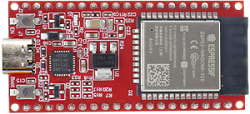|
| 2 |ESP32舵机驱动板|1|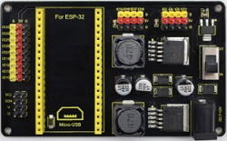|
| 3 |亚克力板|1|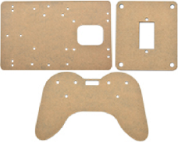|
| 4 |机械手臂部件|1|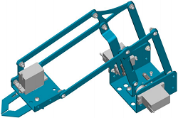|
| 7 |180° 舵机(金属齿轮)|1|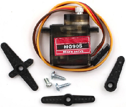|
| 8 |摇杆模块|2|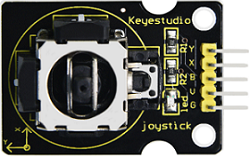|
| 9 |3D PS2摇杆帽|2|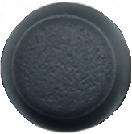|
| 10 |十字螺丝刀|1|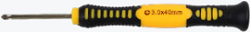|
| 11 |镀锌扳手|1||
| 12 |M2.5*6MM 圆头 十字 螺钉|4|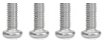|
| 13 |M3*6MM 圆头 十字 螺钉|22|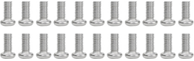|
| 14 |M3*8MM 平头 十字 螺钉|2| 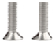 |
| 15 |M2*10MM 圆头 十字 螺钉|2|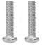|
| 16 |M2.5 螺母|4||
| 17 |M3 螺母|2||
| 18 |M2 螺母|2||
| 19 |M3*10MM 双通铜柱|10|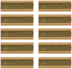|
| 20 |M3*45MM 双通铜柱|4||
| 21 |M2.5*25+6MM 单通铜柱|4|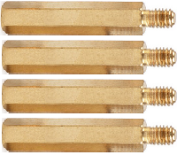|
| 22 |公对母杜邦线10CM| 10 ||
| 23 |母对母杜邦线50CM|20|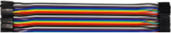|
| 24 |扎带|5|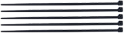|
| 25 |18650电池盒|1|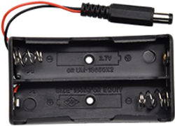|
| 26 |18650充电器|1|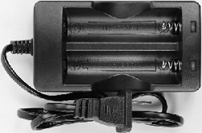|
| 27 |USB线|1|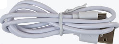|
| 28 |18650电池|2||
| 29 |缠绕管|1|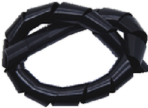|

## 1.6 ESP32主控板

### 1.6.1 简介

keyes ESP32 主控板是基于ESP-WROOM-32E模块所设计的的迷你开发板。该开发板引出大部分I/O引脚至两侧的2.54mm间距的排针，开发者可以根据自己的需求连接外设。使用开发板进行开发和调试时，两侧的标准排针可以让你的操作更加简洁方便。

ESP-WROOM-32E模块是业内集成度领先的 WiFi + 蓝牙解决方案，外部元器件少于 10 个，它集成了天线开关、射频 balun、功率放大器、低噪放大器、过滤器和电源管理模块。同时，采用 TSMC 低功耗 40nm 技术，功耗性能和射频性能，安全可靠，易于扩展至各种应用。

### 1.6.2 参数

- 微控制器：ESP-WROOM-32E模块

- USB转串口芯片：CP2102

- 工作电压：DC 3.3V

- 工作电流：80mA（平均）

- 供电电流：500mA（最小）

- 工作温度范围: -40°C ~ +85°C 

- WiFi模式：站点模式/软AP模式/软AP+站点混合模式/点对点模式（P2P）

- WiFi协议：802.11 b/g/n（802.11n，速度高达 150 Mbps）

- WiFi频率范围：2.4 GHz ~ 2.5 GHz

- 蓝牙协议：符合蓝牙 v4.2 BR/EDR 和 BLE 蓝牙低功耗标准

- 尺寸：56mmx26mmx15mm

- 重量：10g

### 1.6.3 引脚详细说明图

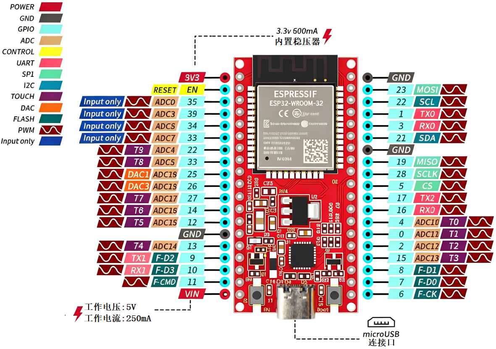

虽然ESP32的引脚数比常用的处理器少，但在引脚上复用多个功能时不会遇到任何问题，IO36，IO35，IO34，IO39只能作为输入脚。

⚠️ **警告**：ESP32引脚的电压电平为3.3V。如果要将ESP32连接到其他工作电压为5V的设备，则应使用电平转换器转换电压电平。

● **电源引脚**：该模块有两个电源引脚+5V和3.3V。你可以使用这两个引脚来向其他设备和模块供电。

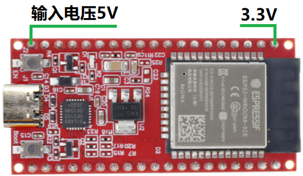

● **GND引脚**：该模块的接地有3个引脚。

● **启用引脚（EN）**：该引脚用于启用和禁用模块。引脚为高电平时启用模块，低电平禁用模块。

● **输入/输出引脚（GPIO）**：您可以使用32个GPIO引脚与LED、开关和其他输入/输出设备进行通信。您可以在内部上拉或下拉这些引脚。

⚠️ **注意：GPIO6至GPIO11引脚（SCK/CLK，SDO/SD0，SDI/SD1，SHD/SD2，SWP/SD3和SCS/CMD引脚）用于模块内部闪存的SPI通信，我们不建议使用它们。**

● **ADC**：您可以使用此模块上的16个ADC引脚将模拟电压（某些传感器的输出）转换为数字电压。其中一些转换器连接到内部放大器，能够以高精度测量小电压。

● **DAC**：ESP32模块有两个数模转换器，精度为8位。

● **触摸焊盘**：ESP32模块上有10个引脚，对电容变化很敏感。您可以将这些引脚连接到某些焊盘（PCB上的焊盘），并将它们用作触摸开关。

● **SPI**：该模块上有两个SPI接口，可用于连接显示屏、SD / microSD存储卡模块、外部闪存等。

● **I2C**：SDA和SCL引脚用于I2C通信。

● **串行通信（UART）：** 该模块上有两个UART串行接口。使用这些引脚，您可以在两个设备之间传输高达5Mbps的信息。 UART0还具有CTS和RTS控制。

● **PWM**：几乎所有ESP32输入/输出引脚都可用于PWM（脉冲宽度调制)。使用这些引脚可以控制电机、LED灯和颜色等。

### 1.6.4 主要部位说明图

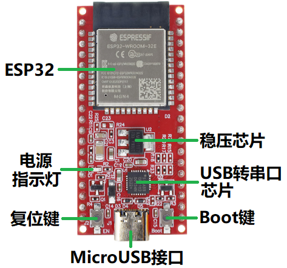

## 1.7 ESP32舵机驱动板

### 1.7.1 简介

ESP32 舵机驱动板拥有8个舵机驱动口（5V）以及9个IO口（3.3V），两个IIC接口（3.3V），舵机驱动采用两个LM2596S-5.0V 3A大电流电源IC给舵机提供工作电压。然后由AMS1117-3.3V SOT-223 稳压块芯片给9个IO口与IIC口供电。 

### 1.7.2 参数

外接电源：7-12V

舵机接口电压：5V

IO口电压：3.3V

尺寸：90mmx55mmx15.5mm

重量：41g（裸板）

### 1.7.3 引脚接口说明图

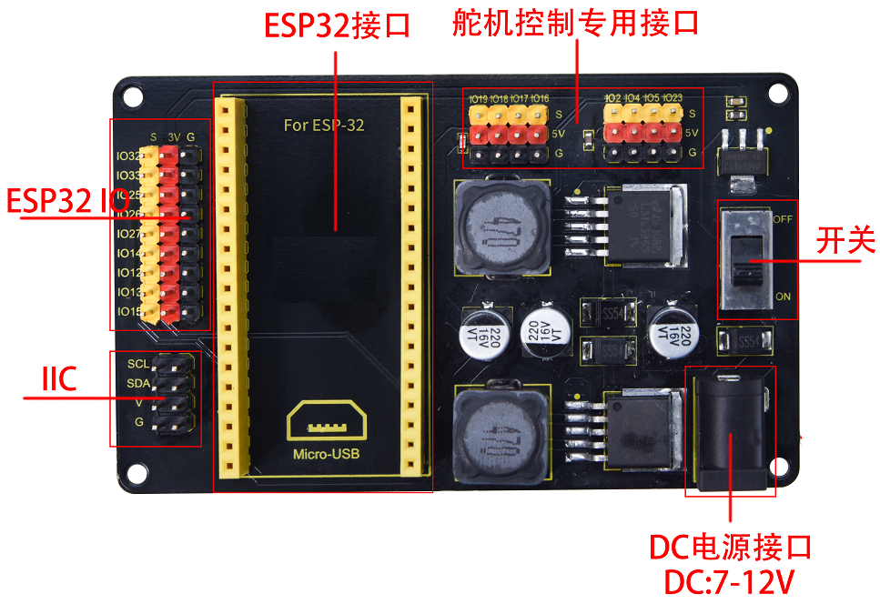

