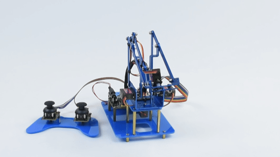

### 第02课 自由伸展  

#### 2.1 项目介绍  

在上一节课中，我们设置了底座舵机（即：整个机械手臂）的来回转动。实际上，我们只需持续改变 4 个舵机的角度，就能让机械手臂完成不同的动作。

#### 2.2 接线图 

⚠️ 特别提醒：机械手臂已经组装好了，这里不需要把4个舵机拆下来又重新组装和接线，这里再次提供接线图，是为了方便您编写代码！

| 左关节舵机 | ESP32舵机驱动板 |
| :----------: | :-------: |
| 黄线 | IO17 |
| 红线 |  5V  |
| 棕线 |  G   |


| 底座舵机 | ESP32舵机驱动板 |
| :----------: | :-------: |
| 黄线 | IO16 |
| 红线 |  5V  |
| 棕线 |  G   |


| 右关节舵机 | ESP32舵机驱动板 |
| :----------: | :-------: |
| 黄线 | IO4 |
| 红线 |  5V |
| 棕线 |  G  |


| 夹爪舵机 | ESP32舵机驱动板 |
| :----------: | :-------: |
| 黄线 | IO5 |
| 红线 |  5V |
| 棕线 |  G  |


<span style="color: rgb(255, 76, 65);">特别注意：接舵机的时候必须要外接供电，因为驱动舵机的电流要求比较大，开发板的电流远远不够。</span>

#### 2.3 实验代码  

```cpp 
#include <ESP32Servo.h>  // 添加舵机库

// 定义4个舵机引脚
const int baseServoPin = 16; // 定义底座舵机的引脚为IO16
const int leftServoPin = 17; // 定义左关节舵机的引脚为IO17
const int rightServoPin = 4; // 定义右关节舵机的引脚为IO4
const int gripperServoPin = 5; // 定义夹爪舵机的引脚为IO5

// 创建舵机对象以控制舵机
Servo myservo1; // 底座舵机
Servo myservo2; // 左关节舵机
Servo myservo3; // 右关节舵机
Servo myservo4; // 夹爪舵机

// 定义舵机角度（就是开机时初始姿态角度值）
int BaseServoAngle = 90;  // 底座舵机初始角度
int LeftServoAngle = 60;  // 左关节舵机初始角度
int RightServoAngle = 130; // 右关节舵机初始角度
int GripperServoAngle = 0;  // 夹爪舵机初始角度

// 平滑移动函数：带末端减速，降低冲击抖动
// 分步延迟：基础延时，数值越大速度越慢越平滑
void smoothMove(Servo &servo, int startAng, int targetAng, int stepDelay = 10){
    startAng = constrain(startAng, 0, 180);
    targetAng = constrain(targetAng, 0, 180);

    if(startAng < targetAng){
        for(int i = startAng; i <= targetAng; i++){
            // 末端减速：离目标越近延时变大，减小机械冲击
            int diff = targetAng - i;
            int d = stepDelay;
            if(diff < 15) d = stepDelay + 3;
            servo.write(i);
            delay(d);
        }
    } else {
        for(int i = startAng; i >= targetAng; i--){
            int diff = i - targetAng;
            int d = stepDelay;
            if(diff < 15) d = stepDelay + 3;
            servo.write(i);
            delay(d);
        }
    }
}

void setup(){
  // 将4个舵机绑定到对应舵机的对象上  
  myservo1.attach(baseServoPin);  
  myservo2.attach(leftServoPin);  
  myservo3.attach(rightServoPin);   
  myservo4.attach(gripperServoPin);

  // 开机时4个舵机的初始状态角度
  myservo1.write(BaseServoAngle);  
  delay(1000);
  myservo2.write(LeftServoAngle);
  delay(1000);
  myservo3.write(RightServoAngle);
  delay(1000);
  myservo4.write(GripperServoAngle);
  delay(1000);
}

void loop(){
  // ========== 每一轮动作开始，先回到初始状态，消除跳变 ==========
  smoothMove(myservo1, myservo1.read(), BaseServoAngle, 10);
  smoothMove(myservo2, myservo2.read(), LeftServoAngle, 10);
  smoothMove(myservo3, myservo3.read(), RightServoAngle, 10);
  smoothMove(myservo4, myservo4.read(), GripperServoAngle, 10);
  delay(1000);

  // 机械手臂左转，底座舵机从90°转到180°
  smoothMove(myservo1, 90, 180, 10);
  delay(1000);

  // 夹爪打开，夹爪舵机从0°转到100°
  smoothMove(myservo4, 0, 100, 10);
  delay(1000);

  // 手臂抬起，左关节舵机从60°转到110°
  smoothMove(myservo2, 60, 110, 10);
  delay(1000);
  
  // 手臂前伸，右关节舵机从130°转到180°
  smoothMove(myservo3, 130, 180, 10);
  delay(1000);

  // 夹爪闭合，夹爪舵机从100°转到0°
  smoothMove(myservo4, 100, 0, 10);
  delay(1000);

  // 手臂后缩，右关节舵机从180°转到120°
  smoothMove(myservo3, 180, 120, 10);
  delay(1000);

  // 手臂放下，左关节舵机从110°转到30°
  smoothMove(myservo2, 110, 30, 10);
  delay(1000);

  // 机械手臂右转，底座舵机从180°转到0°
  smoothMove(myservo1, 180, 0, 10);
  delay(2000);

  // 夹爪打开，夹爪舵机从0°转到100°
  smoothMove(myservo4, 0, 100, 10);
  delay(1000);

  // 手臂抬起，左关节舵机从30°转到110°
  smoothMove(myservo2, 30, 110, 10);
  delay(1000);
  
  // 手臂前伸，右关节舵机从120°转到180°
  smoothMove(myservo3, 120, 180, 10);
  delay(1000);

  // 夹爪闭合，夹爪舵机从100°转到0°
  smoothMove(myservo4, 100, 0, 10);
  delay(1000);

  // 手臂后缩，右关节舵机从180°转到120°
  smoothMove(myservo3, 180, 120, 10);
  delay(1000);

  // 手臂放下，左关节舵机从110°转到30°
  smoothMove(myservo2, 110, 30, 10);
  delay(1000);
}
```  

#### 2.4 代码说明  

```C
#include <ESP32Servo.h>
```
- 这行代码告诉 ESP32，我们要使用ESP32舵机库。

```C
const int baseServoPin = 16; 
const int leftServoPin = 17;
const int rightServoPin = 4;
const int gripperServoPin = 5;
```
- 定义4个舵机的引脚。

```C
Servo myservo1; 
Servo myservo2; 
Servo myservo3; 
Servo myservo4; 
```
- 创建舵机对象以控制舵机。

```C
void smoothMove(Servo &servo, int startAng, int targetAng, int stepDelay = 10){
    startAng = constrain(startAng, 0, 180);
    targetAng = constrain(targetAng, 0, 180);

   if(startAng < targetAng){
        for(int i = startAng; i <= targetAng; i++){
            int diff = targetAng - i;
            int d = stepDelay;
            if(diff < 15) d = stepDelay + 3;
            servo.write(i);
            delay(d);
        }
    } else {
        for(int i = startAng; i >= targetAng; i--){
            int diff = i - targetAng;
            int d = stepDelay;
            if(diff < 15) d = stepDelay + 3;
            servo.write(i);
            delay(d);
        }
    }
} 
```
- 平滑移动函数：带末端减速，降低冲击抖动；

- 分步延迟：基础延时，数值越大速度越慢越平滑。

```C
void setup(){ 
  myservo1.attach(baseServoPin);  
  myservo2.attach(leftServoPin);  
  myservo3.attach(rightServoPin);   
  myservo4.attach(gripperServoPin);

  myservo1.write(BaseServoAngle);  
  delay(1000);
  myservo2.write(LeftServoAngle);
  delay(1000);
  myservo3.write(RightServoAngle);
  delay(1000);
  myservo4.write(GripperServoAngle);
  delay(1000);
}
```
- 在setup()函数中，将4个舵机绑定到对应的舵机对象上，设置开机时4个舵机的初始状态角度。

```C
void loop(){
  smoothMove(myservo1, myservo1.read(), BaseServoAngle, 10);
  smoothMove(myservo2, myservo2.read(), LeftServoAngle, 10);
  smoothMove(myservo3, myservo3.read(), RightServoAngle, 10);
  smoothMove(myservo4, myservo4.read(), GripperServoAngle, 10);
  delay(1000);
  
  smoothMove(myservo1, 90, 180, 10);
  delay(1000);
  smoothMove(myservo4, 0, 100, 10);
  delay(1000);
  smoothMove(myservo2, 60, 100, 10);
  delay(1000);
  smoothMove(myservo3, 130, 180, 10);
  delay(1000);
  smoothMove(myservo4, 100, 0, 10);
  delay(1000);
  smoothMove(myservo3, 180, 120, 10);
  delay(1000);
  smoothMove(myservo2, 110, 30, 10);
  delay(1000);
  smoothMove(myservo1, 180, 0, 10);
  delay(2000);
  smoothMove(myservo4, 0, 100, 10);
  delay(1000);
  smoothMove(myservo2, 60, 100, 10);
  delay(1000);
  smoothMove(myservo3, 130, 180, 10);
  delay(1000);
  smoothMove(myservo4, 100, 0, 10);
  delay(1000);
  smoothMove(myservo3, 180, 120, 10);
  delay(1000);
  smoothMove(myservo2, 110, 30, 10);
  delay(1000);
}
```
- 在loop()函数中，每一轮动作开始，先回到初始姿态，消除跳变；

- 机械手臂进行一系列的动作，例如：手臂左右转、夹爪开与合、手臂前伸与后缩、手臂抬起与放下 等。

#### 2.5 实验结果  

外接电源，将舵机驱动板上的拨码开关拨到 “<span style="color: rgb(255, 76, 65);">ON</span>” 端，上电后。选择好正确的开发板板型（ESP32 Dev Module）和 适当的串口端口（COMxx），然后单击  按钮上传代码至ESP32控制板。

代码上传成功后，机械手臂将实现循环运动：回到初始姿态、手臂向左转、夹爪打开、手臂抬起、手臂前伸、夹爪闭合、手臂后退、手臂放下；随后手臂向右转、夹爪打开、手臂抬起、手臂前伸、夹爪闭合、手臂后退、手臂放下，持续重复该套动作。


 

