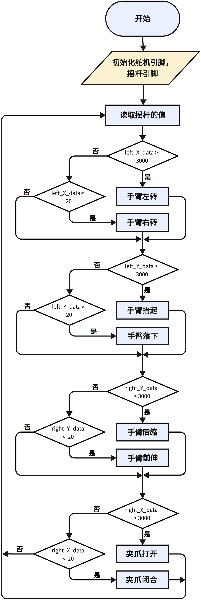
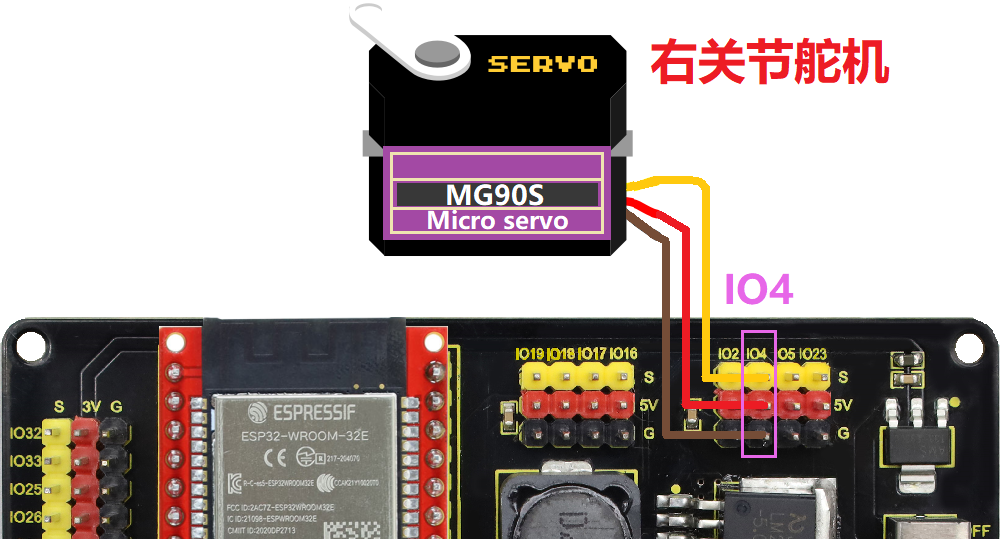
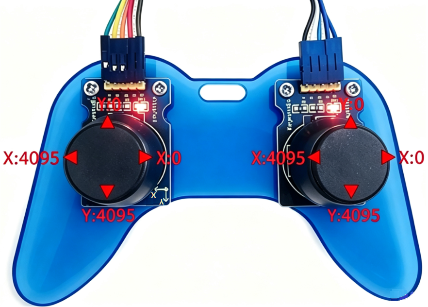
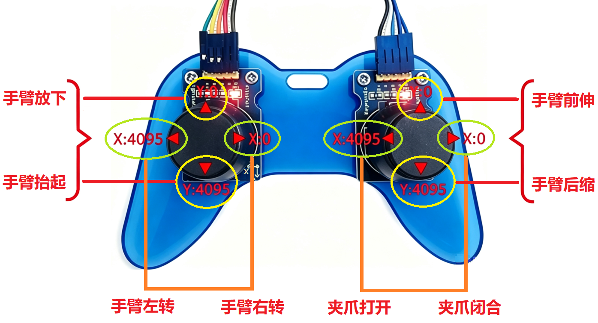
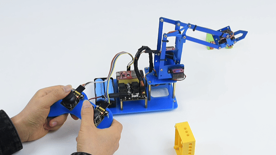

### 第04课 双摇杆控制  

#### 4.1 项目介绍  

在前面的课程中，我们已经介绍了如何读取2个摇杆模块的值，以及如何使用 4 个舵机控制机械手臂。接下来，结合上述两个实验，使用两个摇杆模块控制机械手臂，实现不同的运动。
 
#### 4.2 流程图



#### 4.3 接线图

⚠️ 特别提醒：机械手臂已经组装好了，这里不需要把2个摇杆模块和4个舵机拆下来又重新组装和接线，这里再次提供接线图，是为了方便您编写代码！

| 左关节舵机 | ESP32舵机驱动板 |
| :----------: | :-------: |
| 橙线 | IO17 |
| 红线 |  5V  |
| 棕线 |  G   |


| 底座舵机 | ESP32舵机驱动板 |
| :----------: | :-------: |
| 橙线 | IO16 |
| 红线 |  5V  |
| 棕线 |  G   |


| 右关节舵机 | ESP32舵机驱动板 |
| :----------: | :-------: |
| 橙线 | IO4 |
| 红线 |  5V |
| 棕线 |  G  |



| 夹爪舵机 | ESP32舵机驱动板 |
| :----------: | :-------: |
| 橙线 | IO5 |
| 红线 |  5V |
| 棕线 |  G  |


| 左侧摇杆模块 | ESP32舵机驱动板 |
| :---------: | :-------: |
|      G      |     G     |
|      V      |     3V    |
|      B      |    IO25   |
|      X      |    IO33   |
|      Y      |    IO32   |

| 右侧摇杆模块 | ESP32舵机驱动板 |
| :---------: | :-------: |
|      G      |     G     |
|      V      |     3V    |
|      B      |    IO12   |
|      X      |    IO13   |
|      Y      |    IO15   |


<span style="color: rgb(255, 76, 65);">特别注意：接舵机的时候必须要外接供电，因为驱动舵机的电流要求比较大，开发板的电流远远不够。</span>

#### 4.4 实验代码 

```cpp  
#include "ESP32Servo.h" // 添加舵机库

// 定义左侧摇杆模块的引脚
const int left_X = 33; // 定义左侧摇杆的X引脚为IO33
const int left_Y = 32; // 定义左侧摇杆的Y引脚为IO32
const int left_B = 25; // 定义左侧摇杆的B引脚为IO25

// 定义右侧摇杆模块的引脚
const int right_X = 13; // 定义右侧摇杆的X引脚为IO13
const int right_Y = 15; // 定义右侧摇杆的Y引脚为IO15 
const int right_B = 12; // 定义右侧摇杆的B引脚为IO12

// 定义4个舵机的引脚
const int baseServoPin = 16; // 定义底座舵机的引脚为IO16
const int leftServoPin = 17; // 定义左关节舵机的引脚为IO17
const int rightServoPin = 4; // 定义右关节舵机的引脚为IO4
const int gripperServoPin = 5; // 定义夹爪舵机的引脚为IO5

// 定义变量，用于存放读取到的左右摇杆的值
int left_B_data, left_Y_data, left_X_data, right_B_data, right_X_data, right_Y_data;

// 创建舵机对象以控制舵机
Servo myservo1;  
Servo myservo2;
Servo myservo3;
Servo myservo4;

// 定义4个舵机角度（就是开机时初始状态角度值）
int BaseServoAngle = 90; // 底座舵机初始角度
int LeftServoAngle = 60; // 左关节舵机初始角度
int RightServoAngle = 130; // 右关节舵机初始角度
int GripperServoAngle = 0;  // 夹爪舵机初始角度

void setup() {
  // 设置左、右摇杆的引脚为输入模式  
  pinMode(left_X, INPUT);
  pinMode(left_Y, INPUT);
  pinMode(left_B, INPUT);
  
  pinMode(right_X, INPUT);
  pinMode(right_Y, INPUT);
  pinMode(right_B, INPUT);

  // 将4个舵机绑定到对应舵机对象上  
  myservo1.attach(baseServoPin);  
  myservo2.attach(leftServoPin);  
  myservo3.attach(rightServoPin);   
  myservo4.attach(gripperServoPin); 
 
  // 开机时4个舵机的初始状态角度
  myservo1.write(BaseServoAngle);  
  delay(1000);
  myservo2.write(LeftServoAngle);
  delay(1000);
  myservo3.write(RightServoAngle);
  delay(1000);
  myservo4.write(GripperServoAngle);
  delay(1000);
}

void loop() {
  left_X_data = analogRead(left_X);   // 读取左侧摇杆X引脚的值
  left_Y_data = analogRead(left_Y);   // 读取左侧摇杆Y引脚的值
  left_B_data = digitalRead(left_B);  // 读取左侧摇杆B引脚的值
 
  right_X_data = analogRead(right_X);  // 读取右侧摇杆X引脚的值
  right_Y_data = analogRead(right_Y);  // 读取右侧摇杆Y引脚的值
  right_B_data = digitalRead(right_B);  // 读取右侧摇杆B引脚的值

  Serial.print(" left B:");
  Serial.print(left_B_data);
  Serial.print("    left X:");
  Serial.print(left_X_data);
  Serial.print("    left Y:");
  Serial.println(left_Y_data);
  
  Serial.print("right B:");
  Serial.print(right_B_data);
  Serial.print("   right X:");
  Serial.print(right_X_data);
  Serial.print("   right Y:");
  Serial.println(right_Y_data);
  delay(300);

  base_Servo_Control(); // 底座舵机控制
  left_Servo_Control(); // 左关节舵机控制
  right_Servo_Control(); // 右关节舵机控制
  gripper_Servo_Control(); // 夹爪舵机控制
}

// 底座舵机控制
void base_Servo_Control() {
  if (left_X_data > 3000) {
    while (analogRead(left_X) > 3000) {
      myservo1.write(BaseServoAngle++);
      if (BaseServoAngle >= 180) BaseServoAngle = 180;
      delay(10);
    }
  } else if (left_X_data < 20) {
    while (analogRead(left_X) < 20) {
      myservo1.write(BaseServoAngle--);
      if (BaseServoAngle <= 0) BaseServoAngle = 0;
      delay(10);
    }
  }
}

// 左关节舵机控制
void left_Servo_Control() {
  if (left_Y_data > 3000) {           
    while (analogRead(left_Y) > 3000) {
      myservo2.write(LeftServoAngle++);
      if (LeftServoAngle >= 110) LeftServoAngle = 110;
      delay(10);
    }
  } else if (left_Y_data < 20) {
      while (analogRead(left_Y) < 20) {
      myservo2.write(LeftServoAngle--);
      if (LeftServoAngle <= 0) LeftServoAngle = 0;
      delay(10);
    }
  }
}

// 右关节舵机控制
void right_Servo_Control() {
  if (right_Y_data > 3000) {
    while (analogRead(right_Y) > 3000) {
      myservo3.write(RightServoAngle--);
      if (RightServoAngle <= 60) RightServoAngle = 60;
      delay(10);
    }
  } else if (right_Y_data < 20) {
    while (analogRead(right_Y) < 20) {
      myservo3.write(RightServoAngle++);
      if (RightServoAngle >= 180) RightServoAngle = 180;
      delay(10);
    }
  }
}

// 夹爪舵机控制
void gripper_Servo_Control() {
  if (right_X_data > 3000) {
    while (analogRead(right_X) > 3000) {
      myservo4.write(GripperServoAngle++);
      if (GripperServoAngle >= 100) GripperServoAngle = 100;
      delay(10);
    }
  } else if (right_X_data < 20) {
    while (analogRead(right_X) < 20) {
      myservo4.write(GripperServoAngle--);
      if (GripperServoAngle <= 0) GripperServoAngle = 0;
      delay(10);
    }
  }
}
```

#### 4.5 代码说明

```C
const int left_X = 33; 
const int left_Y = 32;  
const int left_B = 25; 

const int right_X = 13; 
const int right_Y = 15;  
const int right_B = 12; 
```
- 定义左侧摇杆模块与右侧摇杆模块的引脚。

```C
const int baseServoPin = 16; 
const int leftServoPin = 17;
const int rightServoPin = 4;
const int gripperServoPin = 5;
```
- 定义4个舵机的引脚。

```C
int left_B_data, left_Y_data, left_X_data, right_B_data, right_X_data, right_Y_data; 
```
- 定义变量，用于存放读取到的左、右摇杆的值。

```C
Servo myservo1; 
Servo myservo2; 
Servo myservo3; 
Servo myservo4; 
```
- 创建舵机对象以控制舵机。

```C
int BaseServoAngle = 90; 
int LeftServoAngle = 60; 
int RightServoAngle = 130; 
int GripperServoAngle = 0; 
```
- 定义4个舵机角度（就是开机时初始状态角度值）

```C
void setup() { 
  pinMode(left_X, INPUT);
  pinMode(left_Y, INPUT);
  pinMode(left_B, INPUT);
  
  pinMode(right_X, INPUT);
  pinMode(right_Y, INPUT);
  pinMode(right_B, INPUT);
 
  myservo1.attach(baseServoPin);  
  myservo2.attach(leftServoPin);  
  myservo3.attach(rightServoPin);   
  myservo4.attach(gripperServoPin); 
 
  myservo1.write(BaseServoAngle);  
  delay(1000);
  myservo2.write(LeftServoAngle);
  delay(1000);
  myservo3.write(RightServoAngle);
  delay(1000);
  myservo4.write(GripperServoAngle);
  delay(1000);
}
```
- 设置左侧摇杆模块与右侧摇杆模块的引脚为输入模式；

- 将4个舵机绑定到对应的舵机对象上；

- 开机时，设置4个舵机的初始状态角度。

```C
void loop() {
  left_X_data = analogRead(left_X);   
  left_Y_data = analogRead(left_Y);  
  left_B_data = digitalRead(left_B);
 
  right_X_data = analogRead(right_X);  
  right_Y_data = analogRead(right_Y); 
  right_B_data = digitalRead(right_B);  

  base_Servo_Control(); 
  left_Servo_Control(); 
  right_Servo_Control(); 
  gripper_Servo_Control(); 
```
- 读取左右摇杆的值，定义底座舵机控制、左关节舵机控制、右关节舵机控制、夹爪舵机控制等函数。
 
```C
void base_Servo_Control() {
  if (left_X_data > 3000) {
    while (analogRead(left_X) > 3000) {
      myservo1.write(BaseServoAngle++);
      if (BaseServoAngle >= 180) BaseServoAngle = 180;
      delay(10);
    }
  } else if (left_X_data < 20) {
    while (analogRead(left_X) < 20) {
      myservo1.write(BaseServoAngle--);
      if (BaseServoAngle <= 0) BaseServoAngle = 0;
      delay(10);
    }
  }
} 
```
- 这是底座舵机控制的子函数。

```C
void left_Servo_Control() {
  if (left_Y_data > 3000) {           
    while (analogRead(left_Y) > 3000) {
      myservo2.write(LeftServoAngle++);
      if (LeftServoAngle >= 110) LeftServoAngle = 110;
      delay(10);
    }
  } else if (left_Y_data < 20) {
      while (analogRead(left_Y) < 20) {
      myservo2.write(LeftServoAngle--);
      if (LeftServoAngle <= 0) LeftServoAngle = 0;
      delay(10);
    }
  }
}
```
- 这是左关节舵机控制的子函数。

```C
void right_Servo_Control() {
  if (right_Y_data > 3000) {
    while (analogRead(right_Y) > 3000) {
      myservo3.write(RightServoAngle--);
      if (RightServoAngle <= 60) RightServoAngle = 60;
      delay(10);
    }
  } else if (right_Y_data < 20) {
    while (analogRead(right_Y) < 20) {
      myservo3.write(RightServoAngle++);
      if (RightServoAngle >= 180) RightServoAngle = 180;
      delay(10);
    }
  }
}
```
- 这是右关节舵机控制的子函数

```C
void gripper_Servo_Control() {
  if (right_X_data > 3000) {
    while (analogRead(right_X) > 3000) {
      myservo4.write(GripperServoAngle++);
      if (GripperServoAngle >= 100) GripperServoAngle = 100;
      delay(10);
    }
  } else if (right_X_data < 20) {
    while (analogRead(right_X) < 20) {
      myservo4.write(GripperServoAngle--);
      if (GripperServoAngle <= 0) GripperServoAngle = 0;
      delay(10);
    }
  }
}
```
- 这是夹爪舵机控制的子函数

#### 4.6 实验结果  

外接电源，将舵机驱动板上的拨码开关拨到 “<span style="color: rgb(255, 76, 65);">ON</span>” 端，上电后。选择好正确的开发板板型（ESP32 Dev Module）和 适当的串口端口（COMxx），然后单击  按钮上传代码至ESP32控制板。

代码上传成功后，就可以使用手柄控制机械手臂了。左侧摇杆模块的X轴方向控制整个机械手臂旋转（X < 20 右转，X > 3000 左转），Y轴方向控制手臂抬起与放下（Y < 20 手臂放下，Y > 3000 手臂抬起）；右侧摇杆模块X轴方向控制夹爪打开与闭合（X < 20 夹爪闭合，X > 3000 夹爪打开），Y轴方向控制手臂的前伸与后缩（Y < 20 手臂前伸，Y > 3000 手臂后缩）。  

  

 
 
