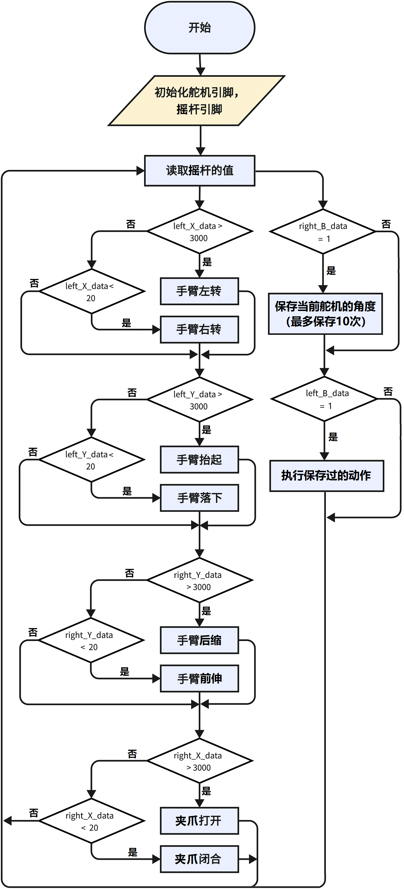
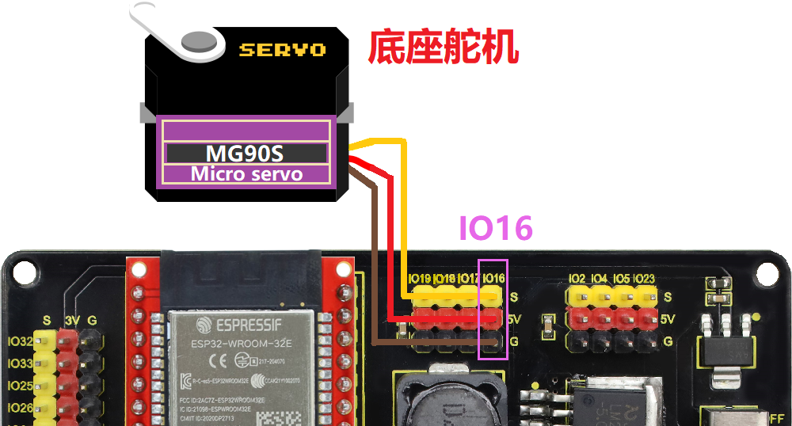
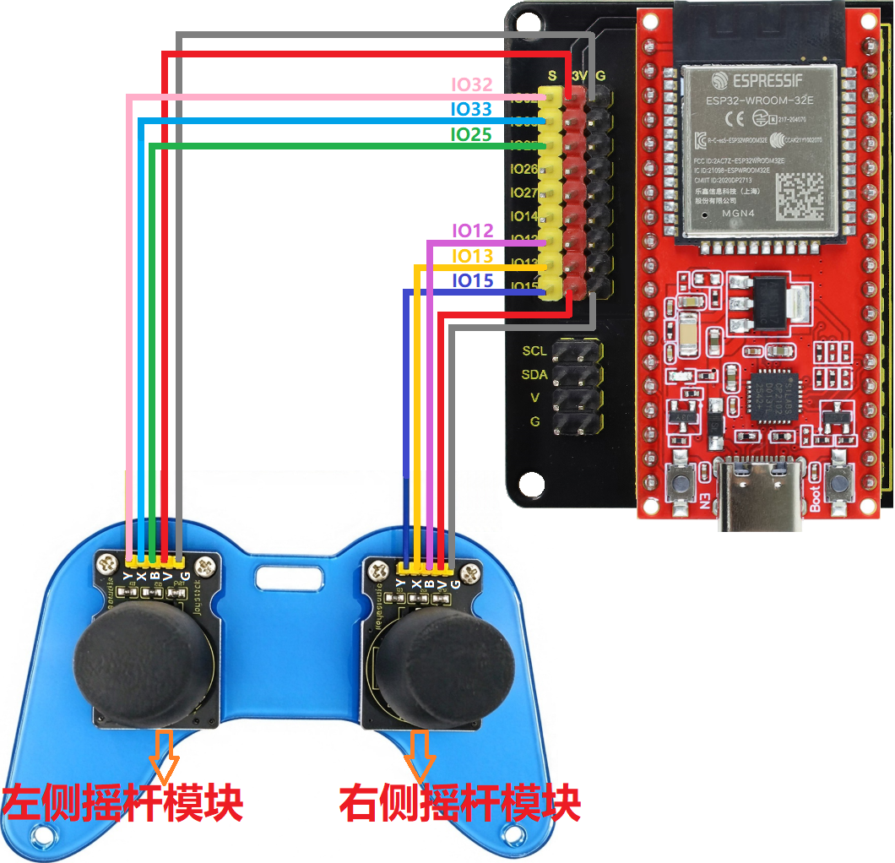
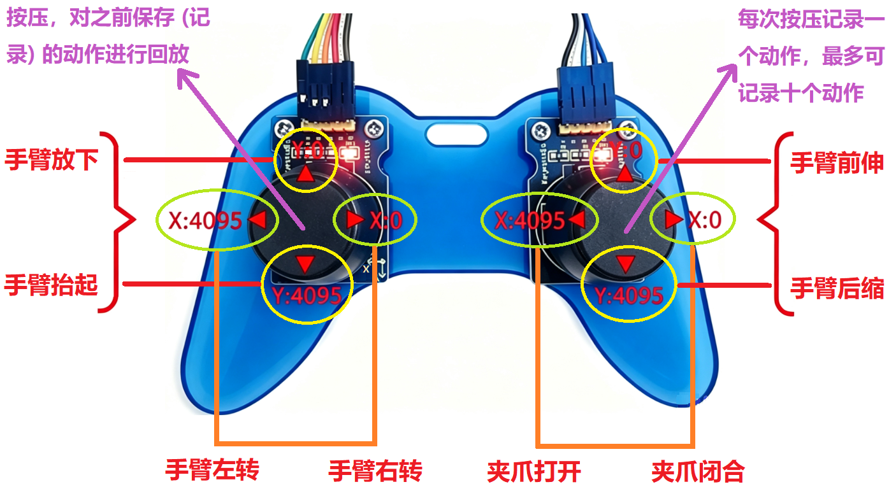
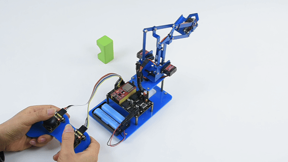

### 第05课 添加记忆功能  

#### 5.1 项目 介绍

通过右侧遥杆模块上的按钮进行存储当前舵机的角度，可以连续存储10次角度，然后通过左侧遥杆模块上的按钮进行进入动作回放。

#### 5.2 流程图



#### 5.3 接线图

⚠️ 特别提醒：机械臂已经组装好了，这里不需要把2个摇杆模块和4个舵机拆下来又重新组装和接线，这里再次提供接线图，是为了方便您编写代码！

| 左关节舵机 | ESP32舵机驱动板 |
| :----------: | :-------: |
| 黄线 | IO17 |
| 红线 |  5V  |
| 棕线 |  G   |


| 底座舵机 | ESP32舵机驱动板 |
| :----------: | :-------: |
| 黄线 | IO16 |
| 红线 |  5V  |
| 棕线 |  G   |



| 右关节舵机 | ESP32舵机驱动板 |
| :----------: | :-------: |
| 黄线 | IO4 |
| 红线 |  5V |
| 棕线 |  G  |


| 夹爪舵机 | ESP32舵机驱动板 |
| :----------: | :-------: |
| 黄线 | IO5 |
| 红线 |  5V |
| 棕线 |  G  |


| 左侧摇杆模块 | ESP32舵机驱动板 |
| :---------: | :-------: |
|      G      |     G     |
|      V      |     3V    |
|      B      |    IO25   |
|      X      |    IO33   |
|      Y      |    IO32   |

| 右侧摇杆模块 | ESP32舵机驱动板 |
| :---------: | :-------: |
|      G      |     G     |
|      V      |     3V    |
|      B      |    IO12   |
|      X      |    IO13   |
|      Y      |    IO15   |



<span style="color: rgb(255, 76, 65);">特别注意：接舵机的时候必须要外接供电，因为驱动舵机的电流要求比较大，开发板的电流远远不够。</span>

#### 5.4 实验代码 

```cpp  
#include "ESP32Servo.h"  // 添加舵机库

// 定义左侧摇杆模块的引脚
const int left_X = 33; // 定义左侧摇杆模块的X引脚为IO33
const int left_Y = 32; // 定义左侧摇杆模块的Y引脚为IO32
const int left_B = 25; // 定义左侧摇杆模块的B引脚为IO25

// 定义右侧摇杆模块的引脚
const int right_X = 13; // 定义右侧摇杆模块的X引脚为IO13
const int right_Y = 15; // 定义右侧摇杆模块的Y引脚为IO15 
const int right_B = 12; // 定义右侧摇杆模块的B引脚为IO12

// 定义4个舵机的引脚
const int baseServoPin = 16; // 定义底座舵机的引脚为IO16
const int leftServoPin = 17; // 定义左关节舵机的引脚为IO17
const int rightServoPin = 4; // 定义右关节舵机的引脚为IO4
const int gripperServoPin = 5; // 定义夹爪舵机的引脚为IO5

// 定义变量，用于存放读取到的左右摇杆的值
int left_B_data, left_Y_data, left_X_data, right_B_data, right_X_data, right_Y_data;

// 创建舵机对象以控制舵机
Servo myservo1;  
Servo myservo2;
Servo myservo3;
Servo myservo4;

// 定义4个舵机角度（就是开机时初始状态角度值）
int BaseServoAngle = 90; // 底座舵机初始角度
int LeftServoAngle = 60; // 左关节舵机初始角度
int RightServoAngle = 130; // 右关节舵机初始角度
int GripperServoAngle = 0;  // 夹爪舵机初始角度

int attitude_data[4][11];
int myservo1_attitude = 0;
int myservo2_attitude = 1;
int myservo3_attitude = 2;
int myservo4_attitude = 3;
int data_start_bit = 1;
int data_end_bit = 0;

void setup() {
  // 设置左、右摇杆的引脚为输入模式  
  pinMode(left_X, INPUT);
  pinMode(left_Y, INPUT);
  pinMode(left_B, INPUT);
  pinMode(right_X, INPUT);
  pinMode(right_Y, INPUT);
  pinMode(right_B, INPUT);

  // 将4个舵机绑定到对应舵机对象上  
  myservo1.attach(baseServoPin);  
  myservo2.attach(leftServoPin);  
  myservo3.attach(rightServoPin);   
  myservo4.attach(gripperServoPin); 
 
  // 开机时4个舵机的初始姿态角度
  myservo1.write(BaseServoAngle);  
  delay(1000);
  myservo2.write(LeftServoAngle);
  delay(1000);
  myservo3.write(RightServoAngle);
  delay(1000);
  myservo4.write(GripperServoAngle);
  delay(1000);
}

void loop() {
  left_X_data = analogRead(left_X); // 读取左侧摇杆X引脚的值
  left_Y_data = analogRead(left_Y); // 读取左侧摇杆Y引脚的值
  left_B_data = digitalRead(left_B); // 读取左侧摇杆B引脚的值
  right_X_data = analogRead(right_X); // 读取右侧摇杆X引脚的值
  right_Y_data = analogRead(right_Y); // 读取右侧摇杆Y引脚的值
  right_B_data = digitalRead(right_B); // 读取右侧摇杆B引脚的值

  attitude();
  base_Servo_Control(); // 底座舵机控制
  left_Servo_Control(); // 左关节舵机控制
  right_Servo_Control(); // 右关节舵机控制
  gripper_Servo_Control(); // 夹爪舵机控制
}

// 底座舵机控制
void base_Servo_Control() {
  if (left_X_data > 3000) {
    while (analogRead(left_X) > 3000) {
      myservo1.write(BaseServoAngle++);
      if (BaseServoAngle >= 180) BaseServoAngle = 180;
      delay(10);
    }
  } else if (left_X_data < 20) {
    while (analogRead(left_X) < 20) {
      myservo1.write(BaseServoAngle--);
      if (BaseServoAngle <= 0) BaseServoAngle = 0;
      delay(10);
    }
  }
}

// 左关节舵机控制
void left_Servo_Control() {
  if (left_Y_data > 3000) {           
    while (analogRead(left_Y) > 3000) {
      myservo2.write(LeftServoAngle++);
      if (LeftServoAngle >= 110) LeftServoAngle = 110;
      delay(10);
    }
  } else if (left_Y_data < 20) {
      while (analogRead(left_Y) < 20) {
      myservo2.write(LeftServoAngle--);
      if (LeftServoAngle <= 0) LeftServoAngle = 0;
      delay(10);
    }
  }
}

// 右关节舵机控制
void right_Servo_Control() {
  if (right_Y_data > 3000) {
    while (analogRead(right_Y) > 3000) {
      myservo3.write(RightServoAngle--);
      if (RightServoAngle <= 60) RightServoAngle = 60;
      delay(10);
    }
  } else if (right_Y_data < 20) {
    while (analogRead(right_Y) < 20) {
      myservo3.write(RightServoAngle++);
      if (RightServoAngle >= 180) RightServoAngle = 180;
      delay(10);
    }
  }
}

// 夹爪舵机控制
void gripper_Servo_Control() {
  if (right_X_data > 3000) {
    while (analogRead(right_X) > 3000) {
      myservo4.write(GripperServoAngle++);
      if (GripperServoAngle >= 100) GripperServoAngle = 100;
      delay(10);
    }
  } else if (right_X_data < 20) {
    while (analogRead(right_X) < 20) {
      myservo4.write(GripperServoAngle--);
      if (GripperServoAngle <= 0) GripperServoAngle = 0;
      delay(10);
    }
  }
}

// 2个摇杆模块控制机械手臂进行一系列动作，每次都可以按下右侧摇杆模块上的按钮进行保存舵机角度，
// 多保存几次（最多可保存10次），按下左侧摇杆模块上的按钮对之前保存的动作进行回放。
void attitude() {
  if (right_B_data == 1) {
    delay(10);  // 消除摇杆的按钮抖动
    if (right_B_data == 1) {
      attitude_data[myservo1_attitude][data_start_bit] = myservo1.read();
      delay(100);
      attitude_data[myservo2_attitude][data_start_bit] = myservo2.read();
      delay(100);
      attitude_data[myservo3_attitude][data_start_bit] = myservo3.read();
      delay(100);
      attitude_data[myservo4_attitude][data_start_bit] = myservo4.read();
      delay(100);
      data_start_bit++;
      data_end_bit = data_start_bit;
      if (data_start_bit > 10) data_start_bit = 10;
    }
  }
  if (left_B_data == 1) {
    delay(10);
    if (left_B_data == 1) {
      data_start_bit = 1;
      BaseServoAngle = myservo1.read();
      LeftServoAngle = myservo2.read();
      RightServoAngle = myservo3.read();
      GripperServoAngle = myservo4.read();
      for (int i = 1; i < data_end_bit; i++) {
        // 底座舵机控制
        if (BaseServoAngle < attitude_data[myservo1_attitude][i]) {
          while (BaseServoAngle < attitude_data[myservo1_attitude][i]) {
            myservo1.write(BaseServoAngle);
            delay(10);
            BaseServoAngle++;
          }
        } else {
          while (BaseServoAngle > attitude_data[myservo1_attitude][i]) {
            myservo1.write(BaseServoAngle);
            delay(10);
            BaseServoAngle--;
          }
        }
        // 左关节舵机控制
        if (LeftServoAngle < attitude_data[myservo2_attitude][i]) {
          while (LeftServoAngle < attitude_data[myservo2_attitude][i]) {
            myservo2.write(LeftServoAngle);
            delay(10);
            LeftServoAngle++;
          }
        } else {
          while (LeftServoAngle > attitude_data[myservo2_attitude][i]) {
            myservo2.write(LeftServoAngle);
            delay(10);
            LeftServoAngle--;
          }
        }
        // 右关节舵机控制
        if (RightServoAngle < attitude_data[myservo3_attitude][i]) {
          while (RightServoAngle < attitude_data[myservo3_attitude][i]) {
            myservo3.write(RightServoAngle);
            delay(10);
            RightServoAngle++;
          }
        } else {
          while (RightServoAngle > attitude_data[myservo3_attitude][i]) {
            myservo3.write(RightServoAngle);
            delay(10);
            RightServoAngle--;
          }
        }
        // 夹爪舵机控制
        if (GripperServoAngle < attitude_data[myservo4_attitude][i]) {
          while (GripperServoAngle < attitude_data[myservo4_attitude][i]) {
            myservo4.write(GripperServoAngle);
            delay(10);
            GripperServoAngle++;
          }
        } else {
          while (GripperServoAngle > attitude_data[myservo4_attitude][i]) {
            myservo4.write(GripperServoAngle);
            delay(10);
            GripperServoAngle--;
          }
        }
      }  
    }
  }
}
```  

#### 5.5 代码说明 

```C
attitude_data[4][11]
```
- 二维数组：`[舵机编号][姿态点位]`

  - 第一维：4 个舵机（0~3，对应 4 个机械手臂舵机）
  
  - 第二维：最多 11 组预设角度点位，存放每个舵机在该点位下的角度值

```C
myservoX_attitude
```
- 舵机行索引，用来选择操作数组里哪一行。

```C
int data_start_bit = 1;
int data_end_bit = 0;
```
- 这里初始状态 `start` > `end`，代表姿态序列为空，没有有效点位。

  - `data_start_bit`：有效姿态序列的起始点位下标
  
  - `data_end_bit`：有效姿态序列的结束点位下标
  
  - 当 `data_start_bit <= data_end_bit` 时，区间 `[data_start_bit, data_end_bit]` 才是需要顺序执行的姿态点。


#### 5.6 实验结果  

外接电源，将舵机驱动板上的拨码开关拨到 “<span style="color: rgb(255, 76, 65);">ON</span>” 端，上电后。选择好正确的开发板板型（ESP32 Dev Module）和 适当的串口端口（COMxx），然后单击  按钮上传代码至ESP32控制板。

代码上传成功后，使用手柄上的2个摇杆模块控制机械手臂进行一系列动作，每次都可以按下右侧摇杆模块上的按钮进行保存舵机角度，多保存几次（最多保存10次），按下左侧摇杆模块上的按钮对之前保存的动作进行回放。

 

 

