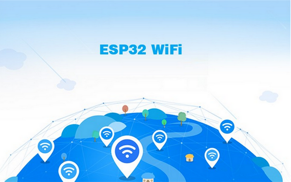
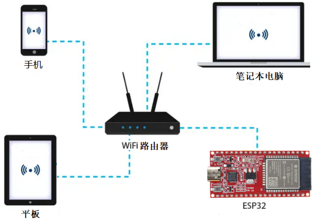
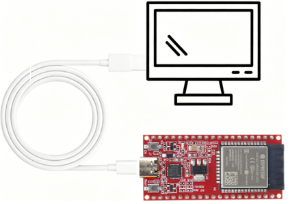
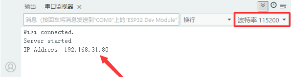
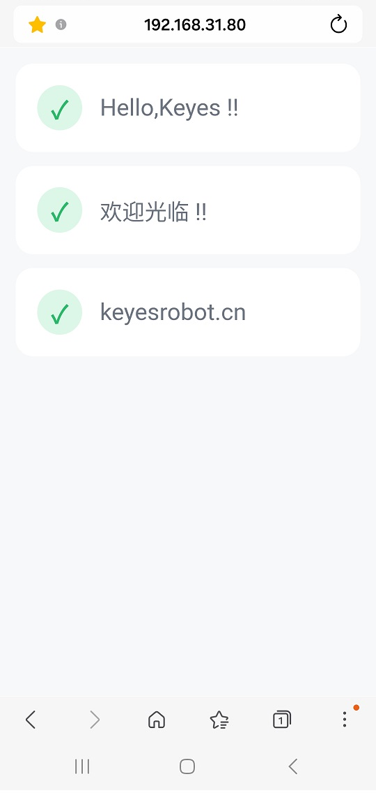
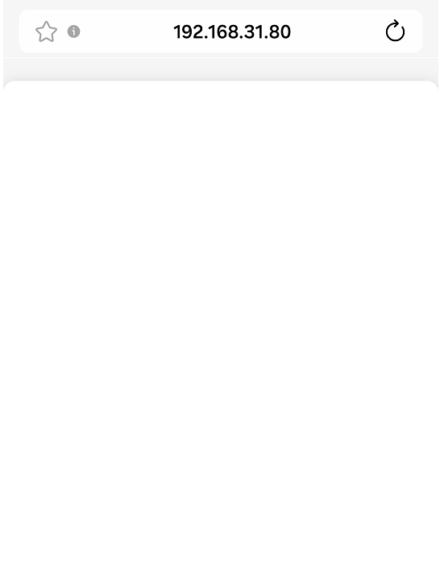
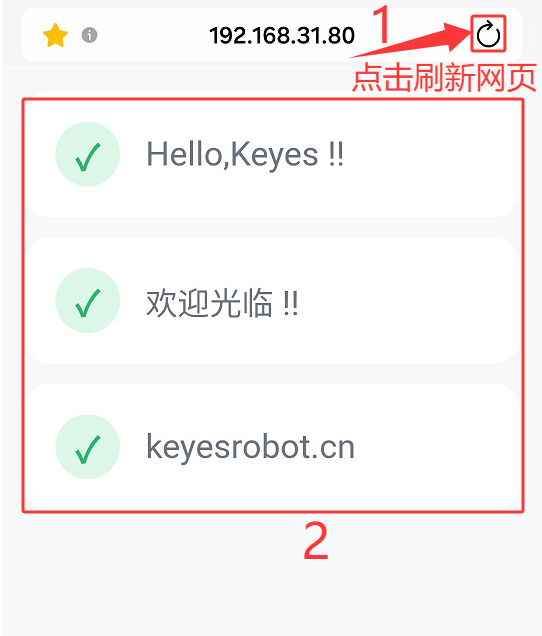

### 第06课 基础网页显示  

#### 6.1 项目介绍  

ESP32开发板带有内置的Wi-Fi（2.4G）和Bluetooth（4.2）功能，可以轻松连接到Wi-Fi网络并与网络中的其他设备进行通信，您可以使用ESP32在浏览器中显示网页，同时网页显示相关内容。



#### 6.2 ESP32‑WiFi 工作模式

ESP32 有一项非常实用的 WiFi 能力，支持两种网络形态：既可以接入路由器的已有 WiFi 网络，搭建网页服务器；也可以自建 WiFi 热点，允许手机、电脑等设备直接连接 ESP32，访问它所提供的网页。

ESP32 的 WiFi 共支持 3 种工作模式：**STA 站点模式、AP 热点模式、STA+AP 混合共存模式**。

1. **Station（STA）站点模式**：作为 WiFi 客户端，主动连接外部路由器的 WiFi 网络。

2. **Soft Access Point（AP）热点模式**：由 ESP32 自身生成 WiFi 热点，其他设备可以直接连接 ESP32。

3. **Station+AP 共存模式**：ESP32 一边连接外部路由器，同时开启自身 WiFi 热点，供其他设备接入。

⚠️ <span style="color: rgb(255, 76, 65);">**重要提示：**</span> 所有 ESP32 的 WiFi 相关程序，在调用 WiFi 功能前，**必须明确配置 WiFi 工作模式**，否则 WiFi 将无法正常运行。

本实验重点学习 **Station（STA）站点模式**。

在 STA 站点模式中，ESP32 作为 WiFi 客户端接入路由器组建的 WiFi 局域网。连接成功后，ESP32 能够和局域网内的手机、平板、电脑等设备相互通信。

**通信逻辑**：手机、平板、电脑接入同一个路由器 WiFi；ESP32 也连接该路由器，即可在局域网中和这些设备进行数据交互。

 

Station 模式下，ESP32 会从所连接的路由器获取分配的 IP 地址。凭借该 IP 地址，ESP32 可以搭建 Web 网页服务器，向同一 WiFi 网络下所有接入的设备提供网页服务。

⚠️ <span style="color: rgb(255, 76, 65);">注意：该通信仅限**同一局域网内部**。如果控制设备与 ESP32 开发板连接的不是同一个 WiFi 网络，将无法访问 Web 服务器控制页面。</span>


更多WIFI参考，请移步到乐鑫官方文档：[https://docs.espressif.com/projects/esp-idf/en/latest/esp32/api-reference/network/esp_wifi.html](https://docs.espressif.com/projects/esp-idf/en/latest/esp32/api-reference/network/esp_wifi.html) 

乐鑫官网：[https://www.espressif.com.cn/en/home](https://www.espressif.com.cn/en)
  
#### 6.3 接线图 

 

#### 6.4 实验代码

⚠️ <span style="color: rgb(255, 76, 65);">**特别提醒：**</span> 打开代码文件后，需要修改ESP32开发板需要连接的WiFi名称与WiFi密码，您需要将 `ChinaNet_2.4G` 和 `ChinaNet@233` 分别替换为您自己的 WiFi名称 和 WiFi密码。WiFi名称和WiFi密码修改后才能上传代码，否则你的ESP32开发板将无法连接网络。

```cpp
const char* ssid = "ChinaNet_2.4G";  // 输入你自己的WiFi名称
const char* password = "ChinaNet@233"; // 输入你自己的WiFi密码
```
⚠️ <span style="color: rgb(255, 76, 65);">**特别注意：**</span> 请确保代码中的WiFi名称和WiFi密码与连接到您的电脑、手机/平板、ESP32开发板和路由器的网络相同，它们必须在同一局域网（WiFi）内。

⚠️ <span style="color: rgb(255, 76, 65);">**特别注意：**</span>  WiFi必须是2.4GHz频率的，否则ESP32无法连接WiFi。

```cpp  
// 添加相关库
#include <WiFi.h>
#include <WebServer.h>

/*请注意:
  ESP32 仅支持 2.4GHz 频段的 WiFi。
  如果 WiFi 连接失败，请检查 WiFi 名称、密码以及频段。
  将 "ChinaNet_2.4G" 修改为你的 WiFi 名称
  将 "ChinaNet@233" 修改为你的 WiFi 密码*/

// =============== WIFI配置 ===============
// 设置WiFi名称和WiFi密码, ESP32 仅支持 2.4GHz 频段的无线网络  
const char* ssid = "ChinaNet_2.4G"; // 替换为你自己的WiFi名称
const char* password = "ChinaNet@233"; // 替换为你自己的WiFi密码

WiFiServer server(80); // 将网页端口设置为80。你可以直接输入IP地址访问网页,无需输入端口号

void setup() {
  Serial.begin(115200); // 设置波特率为115200
  // 连接到 WiFi 网络
  Serial.println();
  Serial.println();
  Serial.print("Connecting to ");
  Serial.println(ssid);
  WiFi.begin(ssid, password);
  while (WiFi.status() != WL_CONNECTED) {
    delay(500);
    Serial.print(".");
  }
  Serial.println("");
  Serial.println("WiFi connected.");
  // 启动服务器
  server.begin();
  Serial.println("Server started");
  // 打印 IP 地址
  Serial.print("IP Address: ");
  Serial.println(WiFi.localIP());
}

void loop() {
  WiFiClient client = server.available(); // 尝试接收来自 WiFi 服务器的请求，并将其分配给名为 client 的 WiFiClient 对象
  if (!client) {                          // 该条件语句用于检查是否已成功接受来自客户端的连接。若未成功，则立即终止执行。
    return;
  }
  Serial.println("New client");
  while (!client.available()) {   // 该循环将一直等待，直到客户端发送请求且数据就绪。等待期间，代码以 1 毫秒为间隔进行延时。
    delay(1);
  }

  // HTML页面，CSS：圆形绿色勾选图标，还原原图样式
  String webPage = "<!DOCTYPE html>";
  webPage += "<html lang='zh-CN'>";
  webPage += "<head>";
  webPage += "<meta charset='UTF-8'>";
  webPage += "<meta name='viewport' content='width=device-width, initial-scale=1.0'>";
  webPage += "<title>Keyes</title>";
  webPage += "<style>";
  webPage += "body {background:#f7f8fa;font-family:system-ui;padding:16px;margin:0;}";
  webPage += ".item{background:#ffffff;border-radius:18px;padding:22px;margin-bottom:14px;display:flex;align-items:center;gap:18px;}";
  /* 圆形绿底 + 白色对勾，和截图一致 */
  webPage += ".check{width:46px;height:46px;border-radius:50%;background:#dcf6e8;color:#28b968;display:flex;justify-content:center;align-items:center;font-size:26px;font-weight:bold;}";
  webPage += ".text{font-size:24px;color:#6b7280;}";
  webPage += "</style>";
  webPage += "</head>";
  webPage += "<body>";
  webPage += "<div class='item'><div class='check'>✓</div><div class='text'>Hello,Keyes !!</div></div>";
  webPage += "<div class='item'><div class='check'>✓</div><div class='text'>欢迎光临 !!</div></div>";
  webPage += "<div class='item'><div class='check'>✓</div><div class='text'>keyesrobot.cn</div></div>";
  webPage += "</body></html>";
    
  client.println("HTTP/1.1 200 OK");         // 发送 HTTP 响应头，表明服务器已成功处理该请求
  client.println("Content-Type: text/html"); // 将响应内容的类型设置为 HTML
  client.println("Connection: close");       // 响应完成后断开与客户端的连接
  client.println();                          // 发送一个空行以结束 HTTP 响应头并开始正文内容
  client.println(webPage);                   // 将定义好的 HTML 页面内容发送给客户端，使客户端收到一条包含“Hello,Keyes !!”、“欢迎光临 !!”、“keyesrobot.cn”的响应消息

  delay(100); // 增加延迟，确保响应完整发送
  client.stop(); // 断开与客户端的连接
}
```  

#### 6.5 代码说明

**头文件与全局变量部分**

```c
#include <WiFi.h>
#include <WebServer.h>
```

- `<WiFi.h>`：ESP32 自带 WiFi 库，负责 WiFi 连接相关功能；

- `<WebServer.h>`：网页服务器库，用来搭建 web 服务，接收浏览器访问请求。

```c
const char* ssid = "ChinaNet_2.4G";     // WiFi名称
const char* password = "ChinaNet@233"; // WiFi密码
WiFiServer server(80);
```

- `ssid`：WiFi 名称，**ESP32 只支持 2.4GHz WiFi，5G 连不上**；

- `password`：WiFi 密码；

- `WiFiServer server(80)`：创建网页服务器，端口号 80。浏览器访问 80 端口时可以不用写端口号，直接输入 IP 地址。

**setup () 初始化函数（上电只运行一次）**

```c
void setup() {
  Serial.begin(115200);
```

- `Serial.begin(115200)`：开启串口通信，波特率 115200；用来在串口监视器打印调试信息（WiFi 连接状态、IP 地址）。

```c
  Serial.println();
  Serial.println();
  Serial.print("Connecting to ");
  Serial.println(ssid);
  WiFi.begin(ssid, password);
```

- `WiFi.begin(ssid, password)`：ESP32 开始尝试连接指定 WiFi

```c
  while (WiFi.status() != WL_CONNECTED) {
    delay(500);
    Serial.print(".");
  }
```

- `while`循环：**等待 WiFi 连接成功**。只要 WiFi 没连上，就每隔 500ms 在串口打印一个`.`，表示正在连接；

- `WiFi.status()`：读取 WiFi 状态；`WL_CONNECTED`代表 WiFi 已成功接入路由器。

```c
  Serial.println("");
  Serial.println("WiFi connected.");
  server.begin();
  Serial.println("Server started");
  Serial.print("IP Address: ");
  Serial.println(WiFi.localIP());
}
```

- `server.begin()`：启动网页服务器，开始监听浏览器的访问请求；

- `WiFi.localIP()`：获取 ESP32 在局域网内的 IP 地址，在串口打印，我们用这个 IP地址 在浏览器打开网页。

**loop () 函数：循环不断执行**

```c
void loop() {
  WiFiClient client = server.available();
  if (!client) {
    return;
  }
```

- `server.available()`：监听有没有浏览器来访问网页
  
  - 如果有人访问 → 返回客户端对象`client`
  
  - 如果没人访问 → `client`为空，直接`return`跳出本次循环，继续等待

- `WiFiClient client`：代表浏览器这个客户端和 ESP32 之间的连接通道。

```c
  Serial.println("New client");
  while (!client.available()) {
    delay(1);
  }
```

- 等待客户端（浏览器）发送完 HTTP 请求数据，数据准备好之后再往下执行。

```c
  String webPage = "<!DOCTYPE html>";
  webPage += "<html lang='zh-CN'>";
  webPage += "<head>";
  webPage += "<meta charset='UTF-8'>";
  webPage += "<meta name='viewport' content='width=device-width, initial-scale=1.0'>";
  webPage += "<title>Keyes</title>";
  webPage += "<style>";
  webPage += "body {background:#f7f8fa;font-family:system-ui;padding:16px;margin:0;}";
  webPage += ".item{background:#ffffff;border-radius:18px;padding:22px;margin-bottom:14px;display:flex;align-items:center;gap:18px;}";
  webPage += ".check{width:46px;height:46px;border-radius:50%;background:#dcf6e8;color:#28b968;display:flex;justify-content:center;align-items:center;font-size:26px;font-weight:bold;}";
  webPage += ".text{font-size:24px;color:#6b7280;}";
  webPage += "</style>";
  webPage += "</head>";
  webPage += "<body>";
  webPage += "<div class='item'><div class='check'>✓</div><div class='text'>Hello,Keyes !!</div></div>";
  webPage += "<div class='item'><div class='check'>✓</div><div class='text'>欢迎光临 !!</div></div>";
  webPage += "<div class='item'><div class='check'>keyesrobot.cn</div></div>";
  webPage += "</body></html>";
```

- `String webPage`：把网页代码全部存到字符串变量里，发送给浏览器；

- HTML：搭建页面结构，3 个卡片条目，每个条目包含圆形对勾 + 文字；

- CSS：设置样式
  
  - 1\. `body`：页面整体背景、边距；
  
  - 2\. `.item`：白色圆角卡片，flex 横向布局，图标和文字并排；
  
  - 3\. `.check`：`border-radius:50%` 做成正圆形，浅绿底色，绿色对勾，居中；
  
  - 4\. `.text`：文字大小、灰色字体，匹配原图。

- `<meta charset='UTF-8'>`：支持中文，防止中文乱码；

- `<meta name='viewport'>`：手机浏览器自适应，不会缩小页面。

```c
  client.println("HTTP/1.1 200 OK");
  client.println("Content-Type: text/html");
  client.println("Connection: close");
  client.println();
  client.println(webPage);
```

- 发送 HTTP 响应头，告诉浏览器：

  - 1\. `HTTP/1.1 200 OK`：请求成功；
  
  - 2\. `Content-Type: text/html`：返回的内容是网页 HTML；
  
  - 3\. `Connection: close`：网页加载完成后断开连接；
  
  - 4\. 空行之后，发送我们写好的网页内容`webPage`。

```c
  delay(100);
  client.stop();
}
```

- `delay(100)`：短暂延时，保证网页数据完整发送完毕；

- `client.stop()`：关闭本次浏览器连接，回到 loop 继续等待下一次访问。

#### 6.6 实验结果  

⚠️ <span style="color: rgb(255, 76, 65);">特别注意：手机/平板（**安卓系统或苹果系统**）和电脑一定要与ESP32开发板连接的是同一个WiFi，否则将无法进入控制页面，还有就是ESP32开发板在使用WiFi功能时功耗很大需要外接直流电源才能满足它的工作电力需求，如果达不到它的工作电力需求ESP32主控板将会一直复位导致代码无法正常运行。</span>

外接电源，将舵机驱动板上的拨码开关拨到 “<span style="color: rgb(255, 76, 65);">ON</span>” 端，上电后。选择好正确的开发板板型（ESP32 Dev Module）和 适当的串口端口（COMxx），然后单击  按钮上传代码至ESP32控制板。

代码上传成功后，单击Arduino IDE右上角的打开串口监视器，设置波特率为115200，串口监视器窗口会打印连接成功后的IP地址。<span style="color: rgb(255, 76, 65);">(注意：如果看不到，可以按下ESP32主控板上的复位按钮重新连接一次)</span> 

  

打开手机/平板（**安卓系统或苹果系统**）浏览器，在网址框中输入ESP32的IP地址，并访问网页。在本例中，您可以在浏览器中输入 “**http://[ESP32的IP地址]**” 来查看网页，如示例中的是 “**192.168.31.80**”，然后进入网页，如下图所示。网页中显示 “Hello,Keyes!!”、“欢迎光临!!”、“keyesrobot\.cn” 等内容。

 

⚠️ <span style="color: rgb(255, 76, 65);">**特别提醒：在浏览器的网址框中输入ESP32的IP地址，然后访问网页，进入对应页面，如果页面显示是空白，如下图所示，那么需要点击  ，刷新页面即可。**</span>






  

