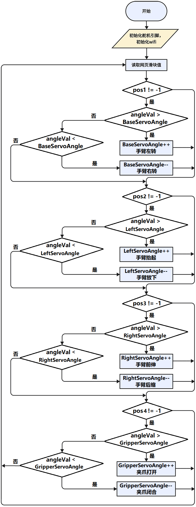
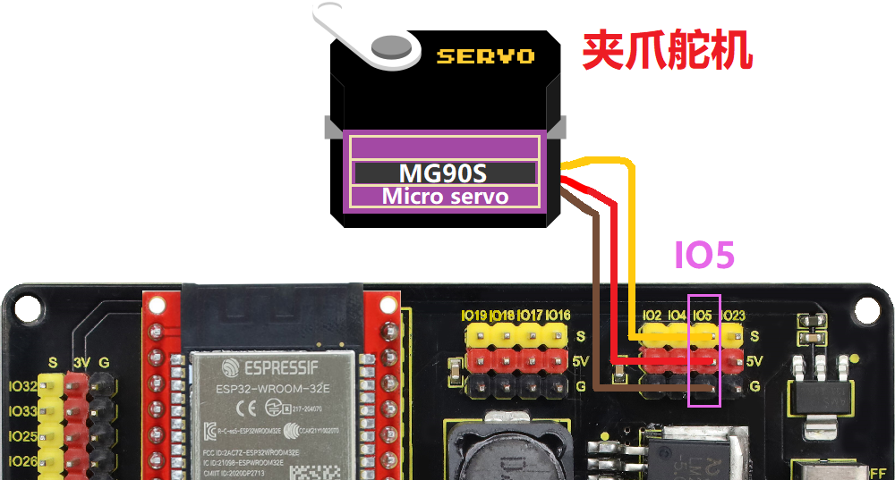
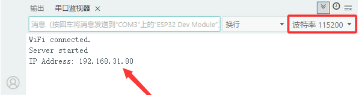
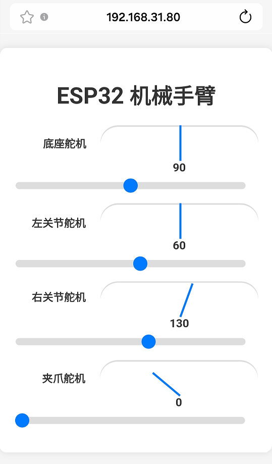
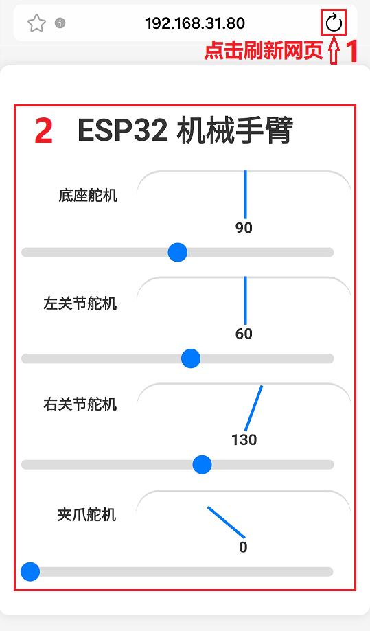
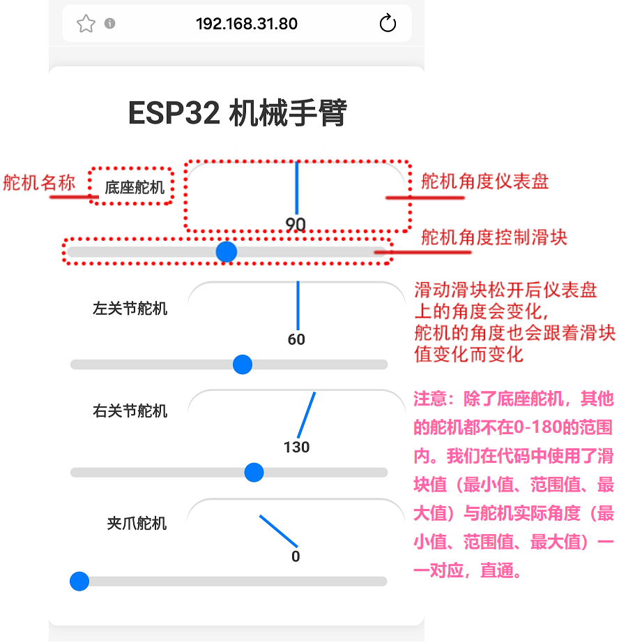
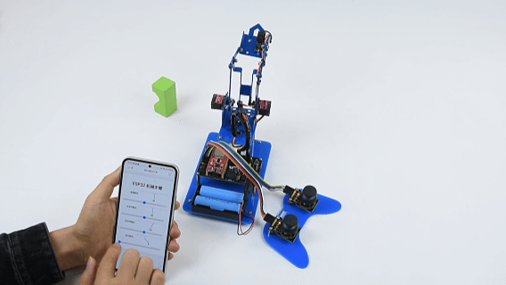

### 第07课 WiFi控制机械手臂  

#### 7.1 项目介绍  

WiFi 机械手臂以 ESP32 作为核心控制器，依托板载 WiFi 功能构建局域网 Web 服务器，实现 **浏览器无线控制机械手臂**。用户使用手机/平板、电脑浏览器访问 IP地址 即可调出可视化控制面板，对机械手臂各关节进行角度调节，完成物体抓取、搬运等操作，无需额外安装控制软件。

#### 7.2 流程图 



#### 7.3 接线图

⚠️ 特别注意：机械手臂已经组装好了，这里不需要把4个舵机拆下来又重新组装和接线，这里再次提供接线图，是为了方便您编写代码！

| 左关节舵机 | ESP32舵机驱动板 |
| :----------: | :-------: |
| 橙线 | IO17 |
| 红线 |  5V  |
| 棕线 |  G   |


| 底座舵机 | ESP32舵机驱动板 |
| :----------: | :-------: |
| 橙线 | IO16 |
| 红线 |  5V  |
| 棕线 |  G   |


| 右关节舵机 | ESP32舵机驱动板 |
| :----------: | :-------: |
| 橙线 | IO4 |
| 红线 |  5V |
| 棕线 |  G  |


| 夹爪舵机 | ESP32舵机驱动板 |
| :----------: | :-------: |
| 橙线 | IO5 |
| 红线 |  5V |
| 棕线 |  G  |



<span style="color: rgb(255, 76, 65);">特别注意：接舵机的时候必须要外接供电，因为驱动舵机的电流要求比较大，开发板的电流远远不够。</span>

#### 7.4 实验代码  

⚠️ <span style="color: rgb(255, 76, 65);">**特别提醒：**</span> 打开代码文件后，需要修改ESP32开发板需要连接的WiFi名称与WiFi密码，您需要将 `ChinaNet_2.4G` 和 `ChinaNet@233` 分别替换为您自己的 WiFi名称 和 WiFi密码。WiFi名称和WiFi密码修改后才能上传代码，否则你的ESP32开发板将无法连接网络。

```cpp
const char* ssid = "ChinaNet_2.4G";  // 输入你自己的WiFi名称
const char* password = "ChinaNet@233"; // 输入你自己的WiFi密码
```
⚠️ <span style="color: rgb(255, 76, 65);">**特别注意：**</span> 请确保代码中的WiFi名称和WiFi密码与连接到您的电脑、手机/平板、ESP32开发板和路由器的网络相同，它们必须在同一局域网（WiFi）内。

⚠️ <span style="color: rgb(255, 76, 65);">**特别注意：**</span>  WiFi必须是2.4GHz频率的，否则ESP32无法连接WiFi。

```cpp  
// 添加相关库
#include <WiFi.h>
#include <WebServer.h>
#include <ESP32Servo.h>

// =============== WIFI配置 ===============
// 设置WiFi名称和WiFi密码, ESP32 仅支持 2.4GHz 频段的无线网络  
const char* ssid = "ChinaNet_2.4G"; // 替换为你自己的WiFi名称
const char* password = "ChinaNet@233"; // 替换为你自己的WiFi密码

WiFiServer server(80); // 将网页端口设置为80。你可以直接输入IP地址访问网页,无需输入端口号

// 4 个舵机引脚
const int BaseServoPin = 16; // 底座舵机
const int LeftServoPin = 17; // 左关节舵机
const int RightServoPin = 4; // 右关节舵机
const int GripperServoPin = 5; // 夹爪舵机

// 舵机对象
Servo myservo1;
Servo myservo2;
Servo myservo3;
Servo myservo4;

// 舵机当前角度（开机初始状态）
int BaseServoAngle = 90;
int LeftServoAngle = 60;
int RightServoAngle = 130;
int GripperServoAngle = 0;

void setup() {
  Serial.begin(115200); // 设置波特率为115200
  
  // 将4个舵机绑定到对应舵机对象上
  myservo1.attach(BaseServoPin);
  myservo2.attach(LeftServoPin);
  myservo3.attach(RightServoPin);
  myservo4.attach(GripperServoPin);
  delay(100);

  // 连接 WiFi
  Serial.println();
  Serial.println();
  Serial.print("Connecting to ");
  Serial.println(ssid);
  WiFi.begin(ssid, password);
  while (WiFi.status() != WL_CONNECTED) {
    delay(500);
    Serial.print(".");
  }
  Serial.println("");
  Serial.println("WiFi connected.");

  server.begin();
  Serial.println("Server started");
  Serial.print("IP Address: ");
  Serial.println(WiFi.localIP());

  // 开机时，四个舵机的初始姿态
  myservo1.write(90);
  delay(200);
  myservo2.write(60);
  delay(200);
  myservo3.write(130);
  delay(200);
  myservo4.write(0);
  delay(200);
}

void loop() {
  WiFiClient client = server.available(); // 尝试接收来自 WiFi 服务器的请求，并将其分配给名为 client 的 WiFiClient 对象
  if (!client) {                         // 该条件语句用于检查是否已成功接受来自客户端的连接。若未成功，则立即终止执行。
    return;
  }
  while (!client.available()) {  // 该循环将一直等待，直到客户端发送请求且数据就绪。等待期间，代码以 1 毫秒为间隔进行延时。
    delay(1);
  }

  String request = client.readStringUntil('\r');
  Serial.println(request);
  client.flush();

  // 读取 4 个舵机当前角度
  BaseServoAngle = myservo1.read();
  LeftServoAngle = myservo2.read();
  RightServoAngle = myservo3.read();
  GripperServoAngle = myservo4.read();

  int pos1 = request.indexOf("slider1=");
  int pos2 = request.indexOf("slider2=");
  int pos3 = request.indexOf("slider3=");
  int pos4 = request.indexOf("slider4=");

  // 解析滑块值：取到字符串末尾，toInt 自动在非数字处停止（不固定截 3 位），再限制 0-180
  if (pos1 != -1) {
    int val1 = constrain(request.substring(pos1 + 8).toInt(), 0, 180);
    Base_Servo_Control(val1);
  }
  if (pos2 != -1) {
    int val2 = constrain(request.substring(pos2 + 8).toInt(), 0, 180);
    Left_Servo_Control(val2);
  }
  if (pos3 != -1) {
    int val3 = constrain(request.substring(pos3 + 8).toInt(), 0, 180);
    Right_Servo_Control(val3);
  }
  if (pos4 != -1) {
    int val4 = constrain(request.substring(pos4 + 8).toInt(), 0, 180);
    Gripper_Servo_Control(val4);
  }

  // ============ HTML 网页（原始字符串，可读性好） ============
  const char webPage[] = R"rawliteral(
<!DOCTYPE html>
<html lang="zh-CN">
<head>
<meta charset="UTF-8">
<meta name="viewport" content="width=device-width, initial-scale=1.0">
<title>ESP32 Servo Control</title>
<style>
body {font-family: Arial, sans-serif;background-color: #f5f5f5;margin: 0;padding: 0;}
.container {max-width: 100%;margin: 20px auto;padding: 20px;background-color: #fff;border-radius: 10px;box-shadow: 0 0 10px rgba(0, 0, 0, 0.1);}
h1 {text-align: center;color: #333;}
.gauge-container {display: flex;align-items: center;margin-bottom: 20px;width: 100%;}
.gauge-label {flex: 1;text-align: right;margin-right: 10px;font-weight: bold;color: #333;}
.gauge {flex: 2;position: relative;width: 100px;height: 50px;}
.gauge:before {content: '';position: absolute;width: 100%;height: 50%;background: #ddd;border-top-left-radius: 100px;border-top-right-radius: 100px;top: 0;left: 0;}
.gauge:after {content: '';position: absolute;width: 100%;height: 50%;background: #fff;border-top-left-radius: 100px;border-top-right-radius: 100px;top: 2px;left: 0;z-index: 1;}
.gauge .needle {width: 3px;height: 50px;background: #007bff;position: absolute;top: 0;left: 50%;transform-origin: 50% 100%;z-index: 2;}
.gauge .value {position: absolute;width: 100%;text-align: center;top: 50px;left: 0;font-weight: bold;color: #333;}
input[type="range"] {width: calc(100% - 20px);-webkit-appearance: none;appearance: none;height: 10px;border-radius: 5px;background-color: #ddd;outline: none;margin-top: 10px;margin-bottom: 20px;}
input[type="range"]::-webkit-slider-thumb {-webkit-appearance: none;appearance: none;width: 20px;height: 20px;border-radius: 50%;background-color: #007bff;cursor: pointer;}
</style>
</head>
<body>
<div class="container">
<h1>ESP32 机械手臂</h1>
<div class="gauge-container"><div class="gauge-label">底座舵机</div><div class="gauge"><div id="needle1" class="needle" style="transform: rotate(0deg);"></div><div id="value1" class="value">90</div></div></div>
<input type="range" min="0" max="180" value="90" oninput="show(this.value,'1')" onchange="update(this.value,'1')">
<div class="gauge-container"><div class="gauge-label">左关节舵机</div><div class="gauge"><div id="needle2" class="needle" style="transform: rotate(0deg);"></div><div id="value2" class="value">60</div></div></div>
<input type="range" min="0" max="110" value="60" oninput="show(this.value,'2')" onchange="update(this.value,'2')">
<div class="gauge-container"><div class="gauge-label">右关节舵机</div><div class="gauge"><div id="needle3" class="needle" style="transform: rotate(10deg);"></div><div id="value3" class="value">130</div></div></div>
<input type="range" min="60" max="180" value="130" oninput="show(this.value,'3')" onchange="update(this.value,'3')">
<div class="gauge-container"><div class="gauge-label">夹爪舵机</div><div class="gauge"><div id="needle4" class="needle" style="transform: rotate(-50deg);"></div><div id="value4" class="value">0</div></div></div>
<input type="range" min="0" max="100" value="0" oninput="show(this.value,'4')" onchange="update(this.value,'4')">
</div>
<script>
// show(): 拖动滑杆时实时更新数值和指针（只改页面，不发请求）
// 滑杆量程与舵机实际角度一一对应: 底座舵机0-180 / 左关节舵机0-110 / 右关节舵机60-180 / 夹爪舵机0-100
// 指针以各滑杆量程：中点 = 底座舵机90 / 左关节舵机55 / 右关节舵机120 / 夹爪舵机50
function show(val, slider) {
  document.getElementById('value' + slider).innerHTML = val;
  var mid = [90, 55, 120, 50][slider - 1];
  var rotation = val - mid;
  document.getElementById('needle' + slider).style.transform = 'rotate(' + rotation + 'deg)';
}
// update(): 松手时提交给 ESP32(带 slider 前缀，与后端 "sliderN=" 解析对应)
function update(val, slider) {
  show(val, slider);
  var xhttp = new XMLHttpRequest();
  xhttp.open('GET', '?' + 'slider' + slider + '=' + val, true);
  xhttp.send();
}
</script>
</body>
</html>
)rawliteral";

  // 带滑块参数的请求：只回轻量 "OK"，不再整页重发（省带宽、响应快）
  if (pos1 != -1 || pos2 != -1 || pos3 != -1 || pos4 != -1) {
    client.println("HTTP/1.1 200 OK");
    client.println("Content-Type: text/plain");
    client.println("Connection: close");
    client.println();
    client.println("OK");
  } else {
    // 打开网页：返回完整页面，并带 Content-Length（规范响应头）
    client.println("HTTP/1.1 200 OK");
    client.println("Content-Type: text/html");
    client.println("Connection: close");
    client.println("Content-Length: " + String(strlen(webPage)));
    client.println();
    client.println(webPage);
  }
}

// ============ 舵机控制（滑杆值与舵机实际角度一一对应，直通） ============

// 底座舵机控制：滑杆值即实际角度（0-180）
void Base_Servo_Control(int angle) {
  int angleVal = constrain(angle, 0, 180); // 底座舵机实际范围 0-180
  Serial.println(angleVal);
  if (angleVal > BaseServoAngle) {
    while (angleVal > BaseServoAngle) {
      myservo1.write(BaseServoAngle++);
      if (BaseServoAngle >= 180) BaseServoAngle = 180;
      delay(10);
    }
  } else if (angleVal < BaseServoAngle) {
    while (angleVal < BaseServoAngle) {
      myservo1.write(BaseServoAngle--);
      if (BaseServoAngle <= 0) BaseServoAngle = 0;
      delay(10);
    }
  }
}

// 左关节舵机控制：实际范围 0-110
void Left_Servo_Control(int angle) {
  int angleVal = constrain(angle, 0, 110); // 左关节舵机实际范围 0-110
  if (angleVal > LeftServoAngle) {
    while (angleVal > LeftServoAngle) {
      myservo2.write(LeftServoAngle++);
      if (LeftServoAngle >= 110) LeftServoAngle = 110;
      delay(10);
    }
  } else if (angleVal < LeftServoAngle) {
    while (angleVal < LeftServoAngle) {
      myservo2.write(LeftServoAngle--);
      if (LeftServoAngle <= 0) LeftServoAngle = 0;
      delay(10);
    }
  }
}

// 右关节舵机控制：实际范围 60-180
void Right_Servo_Control(int angle) {
  int angleVal = constrain(angle, 60, 180); // 右关节舵机实际范围 60-180
  if (angleVal > RightServoAngle) {
    while (angleVal > RightServoAngle) {
      myservo3.write(RightServoAngle++);
      if (RightServoAngle >= 180) RightServoAngle = 180;
      delay(10);
    }
  } else if (angleVal < RightServoAngle) {
    while (angleVal < RightServoAngle) {
      myservo3.write(RightServoAngle--);
      if (RightServoAngle <= 60) RightServoAngle = 60;
      delay(10);
    }
  }
}

// 夹爪舵机控制：实际范围 0-100
void Gripper_Servo_Control(int angle) {
  int angleVal = constrain(angle, 0, 100); // 夹爪舵机实际范围 0-100
  if (angleVal > GripperServoAngle) {
    while (angleVal > GripperServoAngle) {
      myservo4.write(GripperServoAngle++);
      if (GripperServoAngle >= 100) GripperServoAngle = 100;
      delay(10);
    }
  } else if (angleVal < GripperServoAngle) {
    while (angleVal < GripperServoAngle) {
      myservo4.write(GripperServoAngle--);
      if (GripperServoAngle <= 0) GripperServoAngle = 0;
      delay(10);
    }
  }
}
```  

#### 7.5 代码说明  

**第 1 部分：头文件与全局变量定义**

```c
#include <WiFi.h>
#include <WebServer.h>
#include <ESP32Servo.h>
```
- `WiFi.h`：WiFi 联网；

- `WebServer.h`：网页服务器库，用来搭建 web 服务，接收浏览器访问请求；

- `ESP32Servo.h`：ESP32 舵机驱动库，用来生成舵机 PWM 信号。

```c
const char* ssid = "ChinaNet_2.4G";     
const char* password = "ChinaNet@233"; 
WiFiServer server(80); 
```

- `ssid`：WiFi 名称，**ESP32 只支持 2.4GHz WiFi，5G 连不上**；

- `password`：WiFi 密码；

- `WiFiServer server(80)`：创建网页服务器，端口号 80。浏览器访问 80 端口时可以不用写端口号，直接输入 IP 地址。

```c
const int BaseServoPin = 16;  
const int LeftServoPin = 17;  
const int RightServoPin = 4;   
const int GripperServoPin = 5; 

Servo myservo1;
Servo myservo2;
Servo myservo3;
Servo myservo4;

int BaseServoAngle = 90;
int LeftServoAngle = 60;
int RightServoAngle = 130;
int GripperServoAngle = 0;
```

- 4 个`Servo`实例，分别对应 4 个舵机;

- 全局变量保存**当前实际角度**，用来实现**平滑渐变转动**（不直接 write 目标角度）。


**第 2 部分 setup () 上电初始化函数（只执行一次）**

```c
void setup() {
  Serial.begin(115200);
  myservo1.attach(BaseServoPin);
  myservo2.attach(LeftServoPin);
  myservo3.attach(RightServoPin);
  myservo4.attach(GripperServoPin);
  delay(100);
```

- `myservoX.attach(引脚)`：把舵机对象绑定到指定 GPIO，开启 PWM 输出。

```c
  Serial.println();
  Serial.println();
  Serial.print("Connecting to ");
  Serial.println(ssid);
  WiFi.begin(ssid, password);
  while (WiFi.status() != WL_CONNECTED) {
    delay(500);
    Serial.print(".");
  }
  Serial.println("");
  Serial.println("WiFi connected.");
  server.begin();
  Serial.println("Server started");
  Serial.print("IP Address: ");
  Serial.println(WiFi.localIP());
```

- `WiFi.begin()`启动 WiFi 连接；

- while 循环：等待 WiFi 连上，串口打印`.`；

- 连上后启动网页服务器 `server.begin()`，打印 ESP32 局域网 IP，浏览器访问这个 IP。

```c
  myservo1.write(90);
  delay(100);
  myservo2.write(60);
  delay(100);
  myservo3.write(130);
  delay(100);
  myservo4.write(0);
  delay(100);
}
```

- 上电自动让机械手臂回到预设初始角度，每个舵机转动后延时，防止上电瞬间电流冲击。

**第 3 部分 loop () 主循环，不断运行**

```c
void loop() {
  WiFiClient client = server.available();
  if (!client) {
    return;
  }
```

- `server.available()`：监听浏览器访问。**没有客户端访问，直接 return，继续循环**。

```c
  while (!client.available()) {
    delay(1);
  }
  String request = client.readStringUntil('\r');
  Serial.println(request);
  client.flush();
```

- 等待浏览器发送 HTTP 请求报文；

- `readStringUntil('\r')`读取浏览器 GET 请求字符串，串口打印请求内容；

- `client.flush()`清空缓冲区；
  
  - 浏览器发送的请求类似：`GET /?slider1=90 HTTP/1.1`；
  
  - `slider1=xx`就是网页 JS 传过来的舵机角度参数。

```c
  BaseServoAngle = myservo1.read();
  LeftServoAngle = myservo2.read();
  RightServoAngle = myservo3.read();
  GripperServoAngle = myservo4.read();

  int pos1 = request.indexOf("slider1=");
  int pos2 = request.indexOf("slider2=");
  int pos3 = request.indexOf("slider3=");
  int pos4 = request.indexOf("slider4=");
```

- `request.indexOf("slider1=")`：查找请求字符串里有没有`slider1=`，找到返回下标，找不到返回`-1`。

```c
  if (pos1 != -1) {
    int val1 = constrain(request.substring(pos1 + 8).toInt(), 0, 180);
    Base_Servo_Control(val1);
  }
  if (pos2 != -1) {
    int val2 = constrain(request.substring(pos2 + 8).toInt(), 0, 180);
    Left_Servo_Control(val2);
  }
  if (pos3 != -1) {
    int val3 = constrain(request.substring(pos3 + 8).toInt(), 0, 180);
    Right_Servo_Control(val3);
  }
  if (pos4 != -1) {
    int val4 = constrain(request.substring(pos4 + 8).toInt(), 0, 180);
    Gripper_Servo_Control(val4);
  }
```

- `substring(pos1+8)`：截取`slider1=`后面的数字文本（`slider1=`一共 8 个字符）；

- `.toInt()`字符串转整数；

- `constrain(数值，最小值，最大值)`：限制角度范围，防止越界损坏舵机；

- 解析成功后调用对应的舵机平滑控制函数。

```c
  const char webPage[] = R"rawliteral(
<!DOCTYPE html>
<html lang="zh-CN">
<head>
<meta charset="UTF-8">
<meta name="viewport" content="width=device-width, initial-scale=1.0">
<title>ESP32 Servo Control</title>
<style>
/* CSS样式：页面布局、滑块、仪表盘样式 */
</style>
</head>
<body>
<div class="container">
<h1>ESP32 机械手臂</h1>
<!-- 4组仪表盘+滑块 -->
<input type="range" min="0" max="180" value="90" oninput="show(this.value,'1')" onchange="update(this.value,'1')">
...
</div>
<script>
// show(): 拖动滑杆时实时更新数值和指针（只改页面，不发请求）
function show(val, slider) {
  document.getElementById('value' + slider).innerHTML = val;
  var mid = [90, 55, 120, 50][slider - 1];
  var rotation = val - mid;
  document.getElementById('needle' + slider).style.transform = 'rotate(' + rotation + 'deg)';
}
// update(): 松手时提交给 ESP32（带 slider 前缀，与后端 "sliderN=" 解析对应）
function update(val, slider) {
  show(val, slider);
  var xhttp = new XMLHttpRequest();
  xhttp.open('GET', '?' + 'slider' + slider + '=' + val, true);
  xhttp.send();
}
</script>
</body>
</html>
)rawliteral";
```

✅ **前端网页 JS 重点**

- `oninput="show()"`：**拖动滑块过程中**，只在本地网页刷新仪表盘指针，**不向 ESP32 发送网络请求**，页面流畅。

-  `onchange="update()"`：**松开滑块一瞬间**，JS 发起 AJAX GET 请求，把`sliderN=角度`发给 ESP32。

<span style="color: rgb(0, 209, 0);">好处：拖动时不会疯狂刷屏请求，只有松手才下发指令，减少 ESP32 压力。</span>

```c
  if (pos1 != -1 || pos2 != -1 || pos3 != -1 || pos4 != -1) {
    client.println("HTTP/1.1 200 OK");
    client.println("Content-Type: text/plain");
    client.println("Connection: close");
    client.println();
    client.println("OK");
  } else {
    client.println("HTTP/1.1 200 OK");
    client.println("Content-Type: text/html");
    client.println("Connection: close");
    client.println("Content-Length: " + String(strlen(webPage)));
    client.println();
    client.println(webPage);
  }
}
```

- 两种请求区分：

  - 1\. **滑块控制请求（带 slider 参数）**：ESP32 收到后只返回纯文本`OK`，不重新发送整个网页，速度快。  
  
  - 2\. **浏览器第一次打开 IP（无 slider 参数）**：返回完整 HTML 网页，渲染控制面板。

**第 4 部分：4 个舵机平滑控制函数（核心亮点）**

⚠️ <span style="color: rgb(255, 76, 65);">特别提醒：这里以底座舵机为例，其余 3 个逻辑完全一样，只是角度范围不同：</span>

```c
void Base_Servo_Control(int angle) {
  int angleVal = constrain(angle, 0, 180);  
  Serial.println(angleVal);
  if (angleVal > BaseServoAngle) {
    while (angleVal > BaseServoAngle) {
      myservo1.write(BaseServoAngle++);
      if (BaseServoAngle >= 180) BaseServoAngle = 180;
      delay(10);
    }
  } else if (angleVal < BaseServoAngle) {
    while (angleVal < BaseServoAngle) {
      myservo1.write(BaseServoAngle--);
      if (BaseServoAngle <= 0) BaseServoAngle = 0;
      delay(10);
    }
  }
}
```

- 平滑运动原理

  - 不是直接 `myservo1.write(目标角度)`，舵机会猛地一下跳过去，震动大、冲击机械结构。
  
  - 用 while 循环：**每次 + 1° /-1°，延时 10ms**，一步步慢慢走到目标角度，动作顺滑。
  
  - 全局变量 `BaseServoAngle` 记录当前真实角度，每一步自增 / 自减。

- 表格

| 舵机 | 滑块范围 | 实际限制角度 |
| --- | --- | --- |
| 底座舵机 | 0 ~ 180 | 0 ~ 180 |
| 左关节舵机 | 0 ~ 110 | 0 ~ 110 |
| 右关节舵机 | 60 ~ 180 | 60 ~ 180 |
| 夹爪舵机 | 0 ~ 100 | 0 ~ 100 |

⚠️ <span style="color: rgb(255, 76, 65);">注意：网页滑块的 min/max 和后端函数 constrain 限制 **必须保持一致**，否则会出现网页数值和舵机实际动作不一致。</span>


#### 7.6 实验结果  

⚠️ <span style="color: rgb(255, 76, 65);">特别注意：手机/平板（**安卓系统或苹果系统**）和电脑一定要与ESP32开发板连接的是同一个WiFi，否则将无法进入控制页面，还有就是ESP32开发板在使用WiFi功能时功耗很大需要外接直流电源才能满足它的工作电力需求，如果达不到它的工作电力需求ESP32主控板将会一直复位导致代码无法正常运行。</span>

外接电源，将舵机驱动板上的拨码开关拨到 “<span style="color: rgb(255, 76, 65);">ON</span>” 端，上电后。选择好正确的开发板板型（ESP32 Dev Module）和 适当的串口端口（COMxx），然后单击  按钮上传代码至ESP32控制板。

代码上传成功后，单击Arduino IDE右上角的  打开串口监视器，设置波特率为115200，串口监视器窗口会打印连接成功后的IP地址。<span style="color: rgb(255, 76, 65);">(注意：如果看不到，可以按下ESP32主控板上的复位按钮重新连接一次)</span> 

 

打开手机/平板（**安卓系统或苹果系统**）浏览器，在网址框中输入IP地址，如示例中的是 “**192.168.31.80**”，然后进入网页，如下图所示：



⚠️ <span style="color: rgb(255, 76, 65);">**特别提醒：在浏览器的网址框中输入ESP32的IP地址，然后访问网页，进入对应页面，如果页面显示是空白，如下图所示，那么需要点击  ，刷新页面即可。**</span>





**控制页面讲解：**

移动滑块可以达到控制舵机旋转的效果，完成机械手臂对物体抓取、搬运等操作。



 


