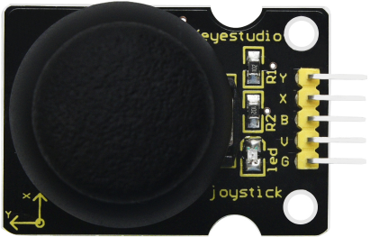
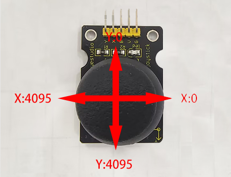
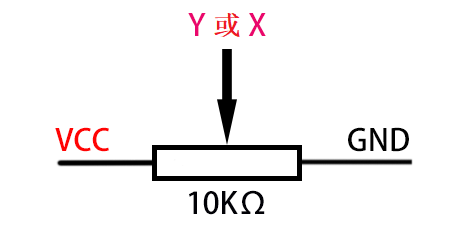
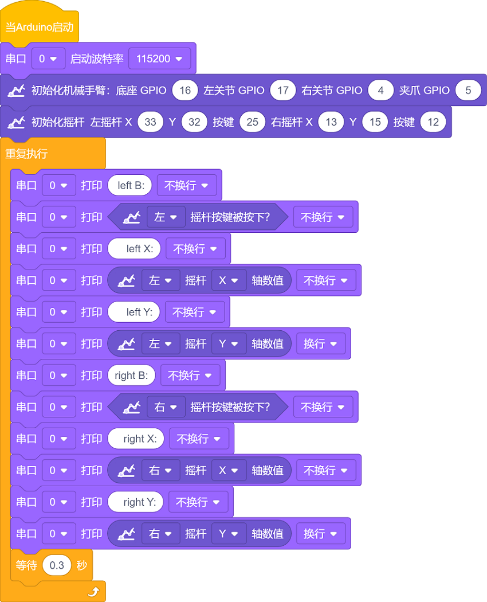
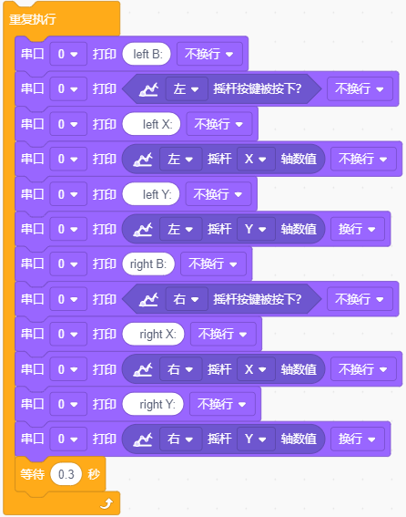
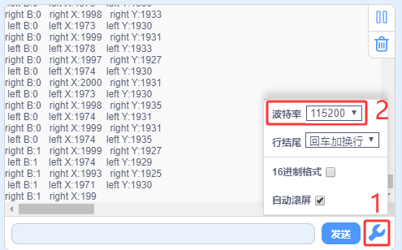

### 第03课 读取摇杆值  

#### 3.1 项目介绍  

摇杆模块包含 2 路模拟输入、1 路数字输入，常用于游戏操控、机器人、无人机等项目。

X、Y 为模拟轴引脚，直接读取模拟数值；Z 轴（B 引脚）为按钮，需先配置引脚为输入模式，按下输出 1，未按下输出 0。读取全部数据并输出至串口监视器。

#### 3.2 模块相关资料

 

**摇杆模块：** 摇杆模块采用PS2手柄摇杆元件。控制时，我们需要将模块X、Y引脚连接到单片机模拟口，B引脚连接单片机数字口，VCC接单片机电源输出端（3.3-5V），GND接单片机GND。我们可以读取两个模拟值和一个数字口的高低电平情况，判断模块上摇杆的工作状态。

**参数：**

- 输入电压：DC 3.3V ~ 5V

- 输出信号：X/Y双轴模拟值 + Z轴（B）数字信号

**工作原理**

摇杆模块原理其实很简单，X和Y轴其实是两个电位器，如下图摇杆往上Y轴的模拟值会减小直到为0，往下Y轴的模拟值会增加直到4095（ESP32的模拟值范围为 0 ~ 4095）；同理X轴也一样，往左模拟值增加，往右模拟值减小。

Y轴往上之所以模拟值会减小，是因为往上时Y轴的输出引脚对地的电阻在减少，所以模拟值也在减小；往下时就是对地的电阻在增加，所以模拟值也增加。X轴也是一样，只不过就是变成了左右。

#### 3.3 接线图 

⚠️ 特别提醒：机械手臂已经组装好了，这里不需要把2个摇杆模块拆下来又重新组装和接线，这里再次提供接线图，是为了方便您编写代码！

| 左侧摇杆模块 | ESP32舵机驱动板 |
| :---------: | :-------: |
|      G      |     G     |
|      V      |     3V    |
|      B      |    IO25   |
|      X      |    IO33   |
|      Y      |    IO32   |

| 右侧摇杆模块 | ESP32舵机驱动板 |
| :---------: | :-------: |
|      G      |     G     |
|      V      |     3V    |
|      B      |    IO12   |
|      X      |    IO13   |
|      Y      |    IO15   |

#### 3.4 实验代码  

 

#### 3.5 代码说明  

- 设置串口波特率为115200。

- 定义4个舵机的引脚。 

- 定义左侧摇杆模块与右边摇杆模块的引脚。

- 读取左侧摇杆与右边摇杆的值，并且在串口监视器窗口打印出来。  

#### 3.6 实验结果  

外接电源，将舵机驱动板上的拨码开关拨到 “ON” 端，上电后。选择好正确的开发板板型（ESP32 Dev Module）和 适当的串口端口（COMxx），然后单击  按钮上传代码至ESP32控制板。

代码上传成功后，单击Kidsblock IDE右下角串口监视器窗口的，设置波特率为115200，你在串口监视器窗口中将看到打印的左右摇杆的值。如果您觉得串口打印速度太快，可以增加等待时间的值。

