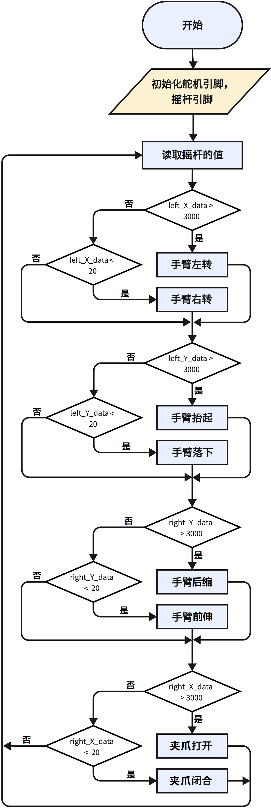
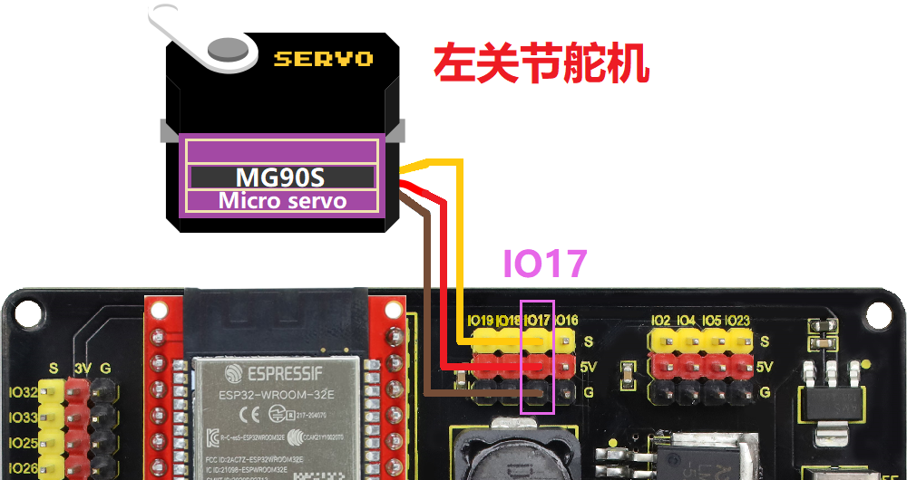
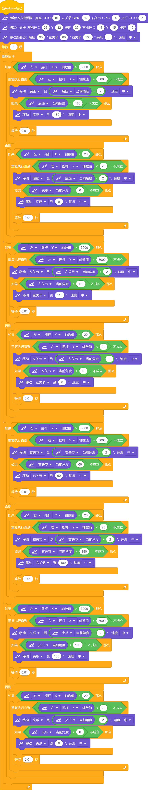
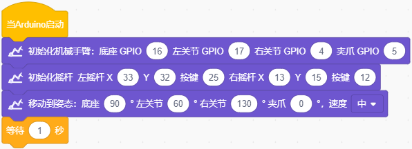
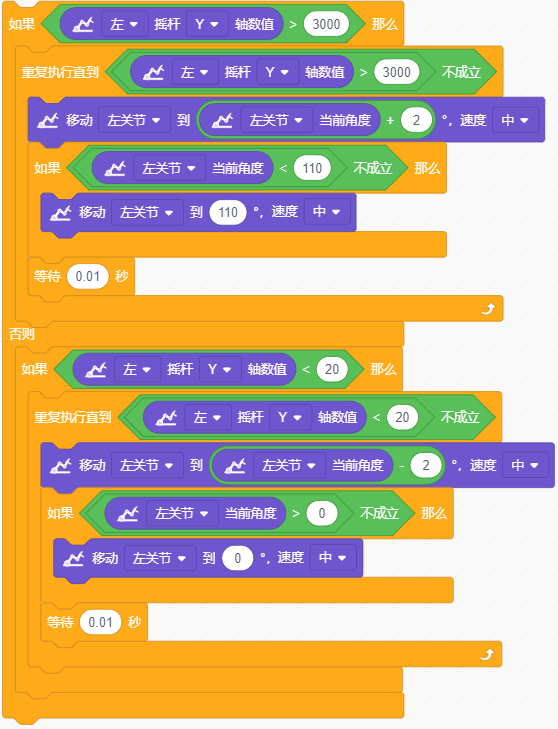
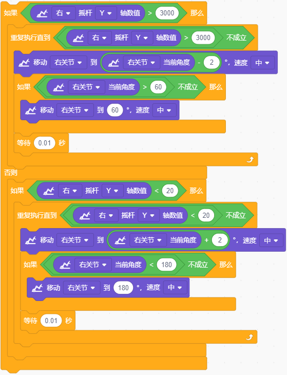
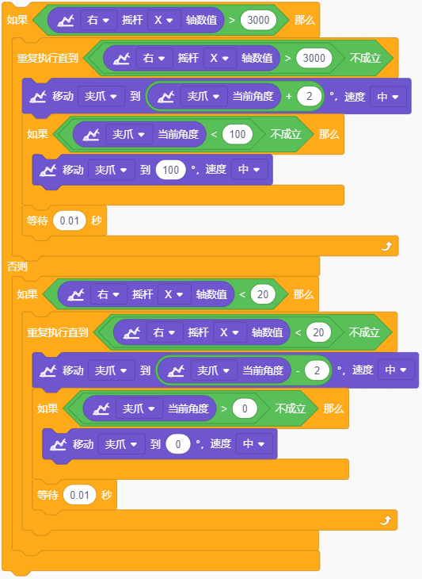
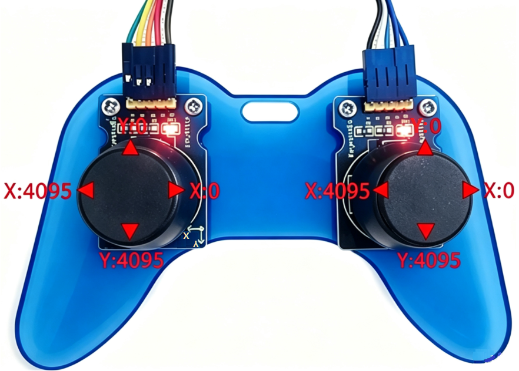
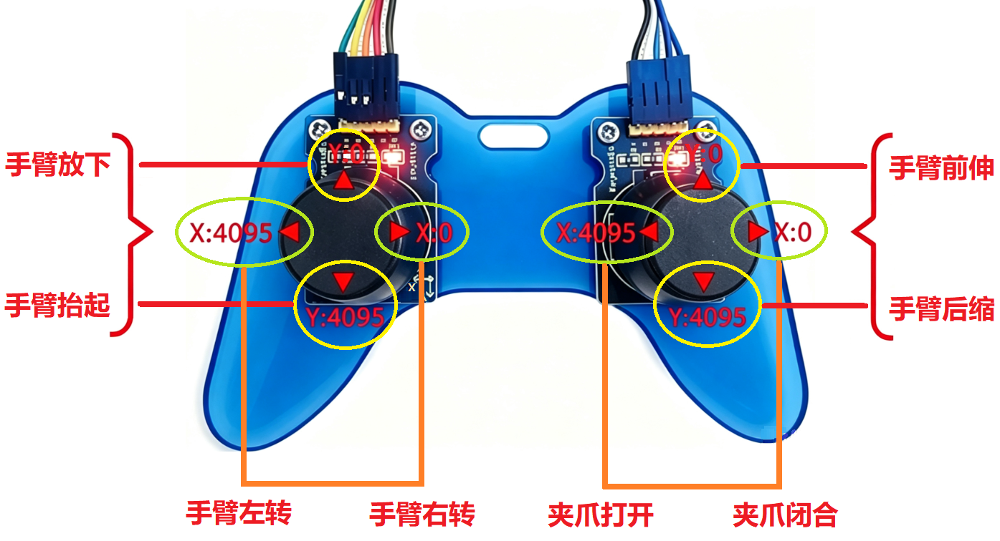
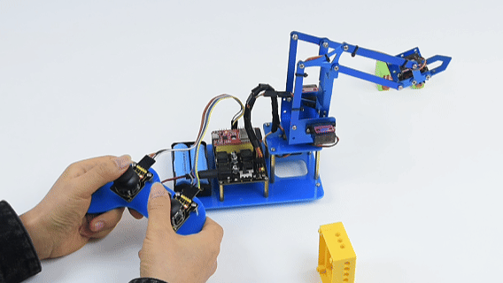

### 第04课 双摇杆控制  

#### 4.1 项目介绍  

在前面的课程中，我们已经介绍了如何读取2个摇杆模块的值，以及如何使用 4 个舵机控制机械手臂。接下来，结合上述两个实验，使用两个摇杆模块控制机械手臂，实现不同的运动。
 
#### 4.2 流程图

#### 4.3 接线图

⚠️ 特别提醒：机械手臂已经组装好了，这里不需要把2个摇杆模块和4个舵机拆下来又重新组装和接线，这里再次提供接线图，是为了方便您编写代码！

| 左关节舵机 | ESP32舵机驱动板 |
| :----------: | :-------: |
| 黄线 | IO17 |
| 红线 |  5V  |
| 棕线 |  G   |

| 底座舵机 | ESP32舵机驱动板 |
| :----------: | :-------: |
| 黄线 | IO16 |
| 红线 |  5V  |
| 棕线 |  G   |

| 右关节舵机 | ESP32舵机驱动板 |
| :----------: | :-------: |
| 黄线 | IO4 |
| 红线 |  5V |
| 棕线 |  G  |

| 夹爪舵机 | ESP32舵机驱动板 |
| :----------: | :-------: |
| 黄线 | IO5 |
| 红线 |  5V |
| 棕线 |  G  |

| 左侧摇杆模块 | ESP32舵机驱动板 |
| :---------: | :-------: |
|      G      |     G     |
|      V      |     3V    |
|      B      |    IO25   |
|      X      |    IO33   |
|      Y      |    IO32   |

| 右侧摇杆模块 | ESP32舵机驱动板 |
| :---------: | :-------: |
|      G      |     G     |
|      V      |     3V    |
|      B      |    IO12   |
|      X      |    IO13   |
|      Y      |    IO15   |

特别注意：接舵机的时候必须要外接供电，因为驱动舵机的电流要求比较大，开发板的电流远远不够。

#### 4.4 实验代码 

 

#### 4.5 代码解释

- 定义4个舵机的引脚。

- 定义左侧摇杆模块与右侧摇杆模块的引脚。

- 设置开机时4个舵机的初始状态角度。
 
- 延时1秒。

- 左侧摇杆模块的X轴方向控制底座舵机左右转动（即：机械手臂左右转动）。

- 左侧摇杆模块的Y轴方向控制左关节舵机上下转动（即：手臂抬起与放下）。

- 右侧摇杆模块的Y轴方向控制右关节舵机前后转动（即：手臂前伸与后缩）。

- 右侧摇杆模块的X轴方向控制夹爪舵机开与合。

#### 4.6 实验结果  

外接电源，将舵机驱动板上的拨码开关拨到 “ON” 端，上电后。选择好正确的开发板板型（ESP32 Dev Module）和 适当的串口端口（COMxx），然后单击  按钮上传代码至ESP32控制板。

代码上传成功后，就可以使用手柄控制机械手臂了。左侧遥杆模块的X轴方向控制整个机械手臂旋转（X < 20 右转，X > 3000 左转），Y轴方向控制手臂抬起与放下（Y < 20 手臂放下，Y > 3000 手臂抬起）；右侧遥杆模块X轴方向控制夹爪打开与闭合（X < 20 夹爪闭合，X > 3000 夹爪打开），Y轴方向控制手臂的前伸与后缩（Y < 20 手臂前伸，Y > 3000 手臂后缩）。 

  

 
 

