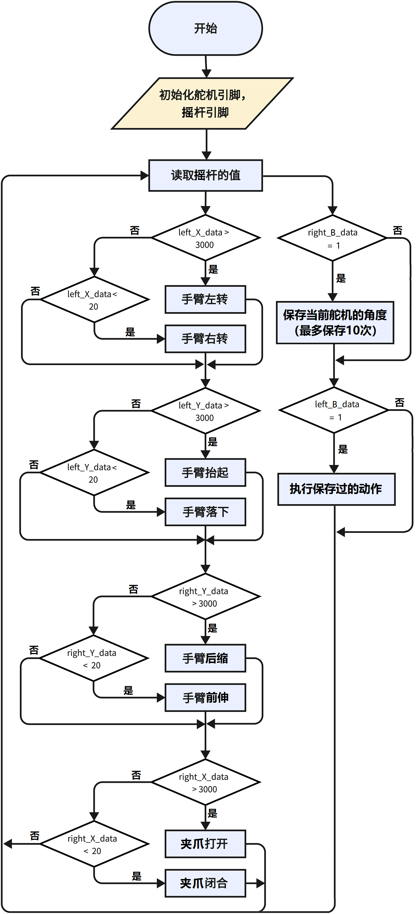
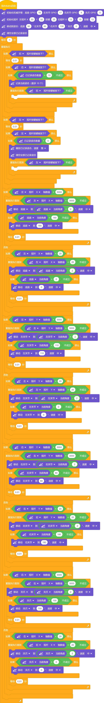
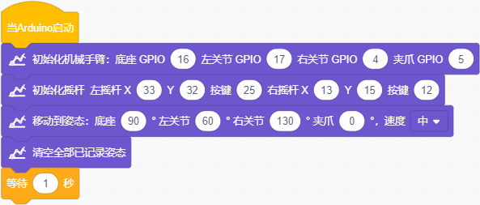
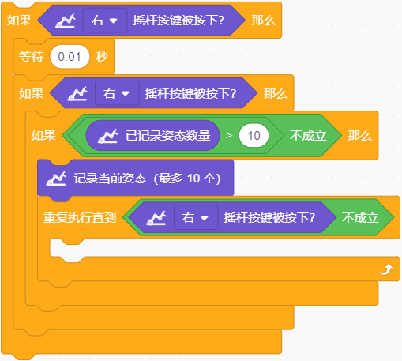
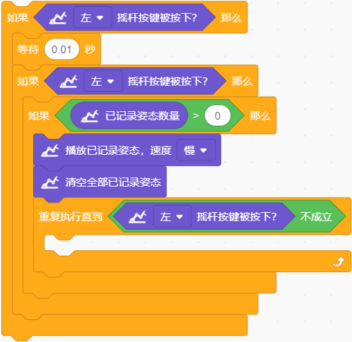
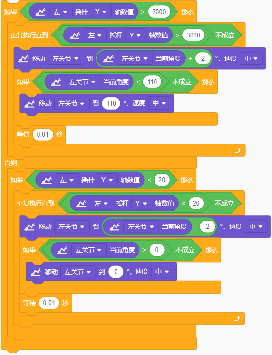
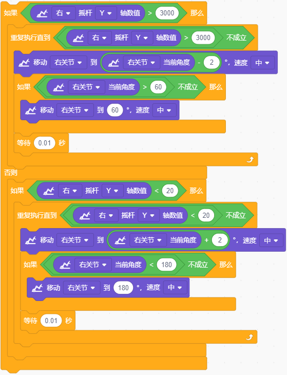
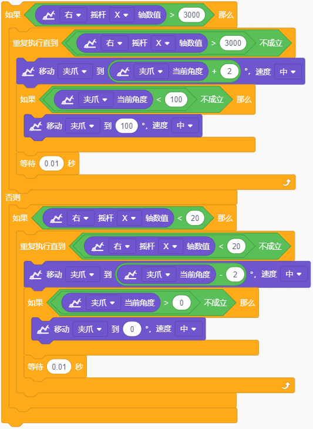
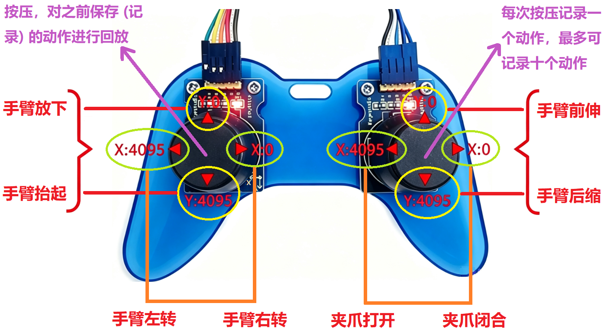
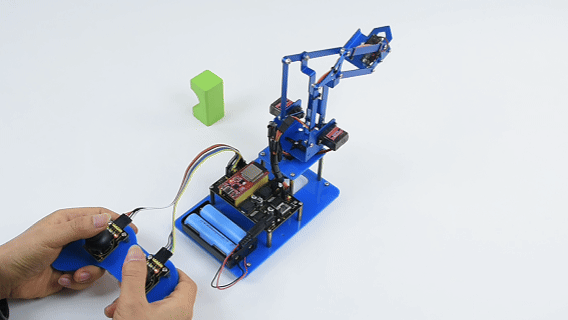

### 第05课 添加记忆功能  

#### 5.1 项目介绍

通过右侧摇杆模块上的按钮进行存储当前舵机的角度，可以连续存储10次角度，然后通过左侧摇杆模块上的按钮进行进入动作回放。

#### 5.2 流程图

**特别提醒：回放结束后已保存的姿态会被清空，如需再次回放请重新记录。**

#### 5.3 接线图

⚠️ 特别提醒：机械臂已经组装好了，这里不需要把2个摇杆模块和4个舵机拆下来又重新组装和接线，这里再次提供接线图，是为了方便您编写代码！

| 左关节舵机 | ESP32舵机驱动板 |
| :----------: | :-------: |
| 橙线 | IO17 |
| 红线 |  5V  |
| 棕线 |  G   |

| 底座舵机 | ESP32舵机驱动板 |
| :----------: | :-------: |
| 橙线 | IO16 |
| 红线 |  5V  |
| 棕线 |  G   |

| 右关节舵机 | ESP32舵机驱动板 |
| :----------: | :-------: |
| 橙线 | IO4 |
| 红线 |  5V |
| 棕线 |  G  |

| 夹爪舵机 | ESP32舵机驱动板 |
| :----------: | :-------: |
| 橙线 | IO5 |
| 红线 |  5V |
| 棕线 |  G  |

| 左侧摇杆模块 | ESP32舵机驱动板 |
| :---------: | :-------: |
|      G      |     G     |
|      V      |     3V    |
|      B      |    IO25   |
|      X      |    IO33   |
|      Y      |    IO32   |

| 右侧摇杆模块 | ESP32舵机驱动板 |
| :---------: | :-------: |
|      G      |     G     |
|      V      |     3V    |
|      B      |    IO12   |
|      X      |    IO13   |
|      Y      |    IO15   |

特别注意：接舵机的时候必须要外接供电，因为驱动舵机的电流要求比较大，开发板的电流远远不够。

#### 5.4 实验代码 

#### 5.5 代码说明 

- 定义4个舵机的引脚。

- 定义左侧摇杆模块与右侧摇杆模块的引脚。

- 设置开机时4个舵机的初始状态角度。

- 清空全部已记录姿态。

- 按下右侧摇杆模块的按钮，进行存储当前舵机的角度，可以连续存储10次角度。

- 按下左侧摇杆模块的按钮对之前保存的动作进行回放。 

- 左侧摇杆模块的X轴方向控制底座舵机左右转动（即：机械手臂左右转动）。

- 左侧摇杆模块的Y轴方向控制左关节舵机上下转动（即：手臂抬起与放下）。

- 右侧摇杆模块的Y轴方向控制右关节舵机前后转动（即：手臂前伸与后缩）。

- 右侧摇杆模块的X轴方向控制夹爪舵机开与合。

#### 5.6 实验结果  

外接电源，将舵机驱动板上的拨码开关拨到 “ON” 端，上电后。选择好正确的开发板板型（ESP32 Dev Module）和 适当的串口端口（COMxx），然后单击 按钮上传代码至ESP32控制板。

代码上传成功后，使用手柄上的2个摇杆模块控制机械手臂进行一系列动作，每次都可以按下右侧摇杆模块上的按钮进行保存舵机角度，多保存几次（最多可保存10次），按下左侧摇杆模块上的按钮对之前保存的动作进行回放。

 

 

