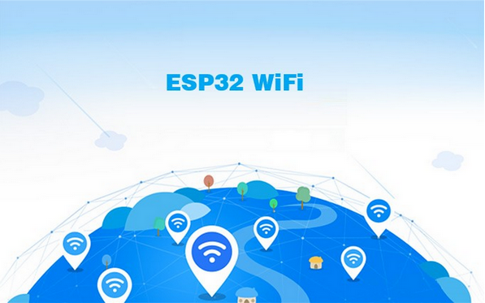
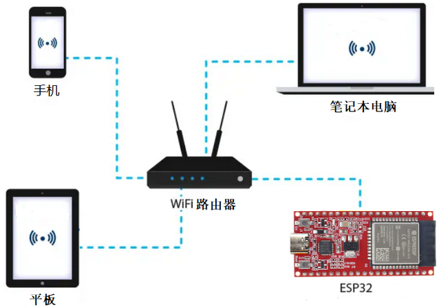
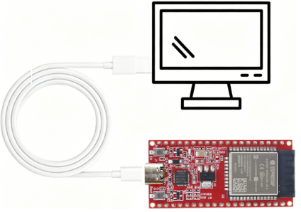
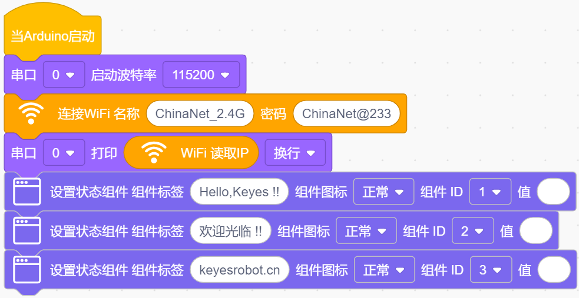
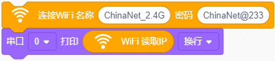
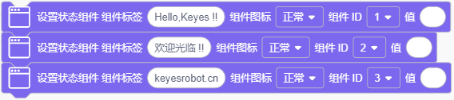
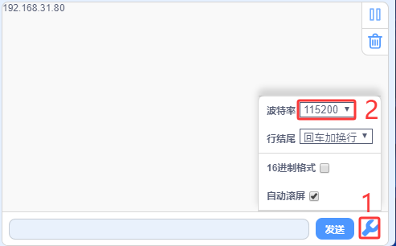
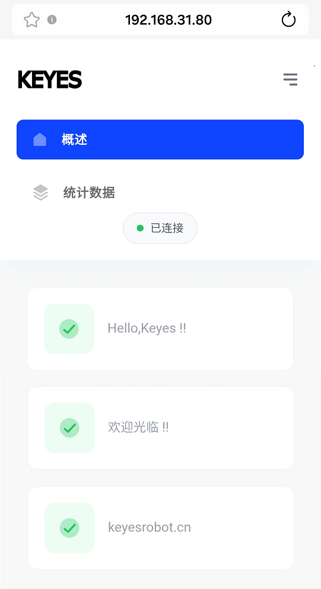
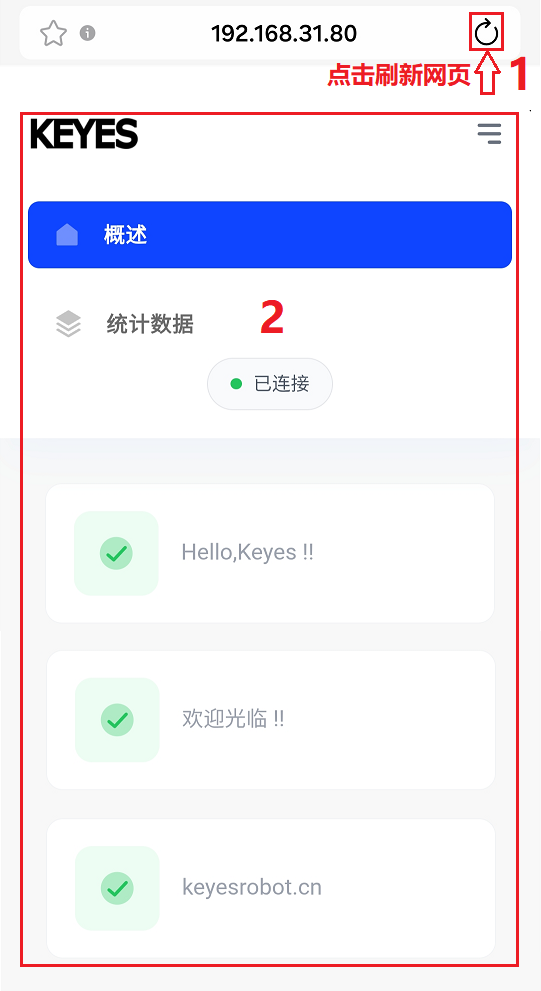

### 第06课 基础网页显示  

#### 6.1 项目介绍  

ESP32开发板带有内置的Wi-Fi（2.4G）和Bluetooth（4.2）功能，可以轻松连接到Wi-Fi网络并与网络中的其他设备进行通信，您可以使用ESP32在浏览器中显示网页，同时网页显示相关内容。

#### 6.2 ESP32‑WiFi 工作模式

ESP32 有一项非常实用的 WiFi 能力，支持两种网络形态：既可以接入路由器的已有 WiFi 网络，搭建网页服务器；也可以自建 WiFi 热点，允许手机、电脑等设备直接连接 ESP32，访问它所提供的网页。

ESP32 的 WiFi 共支持 3 种工作模式：**STA 站点模式、AP 热点模式、STA+AP 混合共存模式**。

1. **Station（STA）站点模式**：作为 WiFi 客户端，主动连接外部路由器的 WiFi 网络。

2. **Soft Access Point（AP）热点模式**：由 ESP32 自身生成 WiFi 热点，其他设备可以直接连接 ESP32。

3. **Station+AP 共存模式**：ESP32 一边连接外部路由器，同时开启自身 WiFi 热点，供其他设备接入。

⚠️ **重要提示：** 所有 ESP32 的 WiFi 相关程序，在调用 WiFi 功能前，**必须明确配置 WiFi 工作模式**，否则 WiFi 将无法正常运行。

本实验重点学习 **Station（STA）站点模式**。

在 STA 站点模式中，ESP32 作为 WiFi 客户端接入路由器组建的 WiFi 局域网。连接成功后，ESP32 能够和局域网内的手机、平板、电脑等设备相互通信。

**通信逻辑**：手机、平板、电脑接入同一个路由器 WiFi；ESP32 也连接该路由器，即可在局域网中和这些设备进行数据交互。

 

Station 模式下，ESP32 会从所连接的路由器获取分配的 IP 地址。凭借该 IP 地址，ESP32 可以搭建 Web 网页服务器，向同一 WiFi 网络下所有接入的设备提供网页服务。

⚠️ 注意：该通信仅限**同一局域网内部**。如果控制设备与 ESP32 开发板连接的不是同一个 WiFi 网络，将无法访问 Web 服务器控制页面。

更多WIFI参考，请移步到乐鑫官方文档：[https://docs.espressif.com/projects/esp-idf/en/latest/esp32/api-reference/network/esp_wifi.html](https://docs.espressif.com/projects/esp-idf/en/latest/esp32/api-reference/network/esp_wifi.html) 

乐鑫官网：[https://www.espressif.com.cn/en/home](https://www.espressif.com.cn/en/home)
  
#### 6.3 接线图 

 

#### 6.4 实验代码

⚠️ **特别提醒：** 打开代码文件后，需要修改ESP32开发板需要连接的WiFi名称与WiFi密码，您需要将 `ChinaNet_2.4G` 和 `ChinaNet@233` 分别替换为您自己的 WiFi名称 和 WiFi密码。WiFi名称和WiFi密码修改后才能上传代码，否则你的ESP32开发板将无法连接网络。

⚠️ **特别注意：** 请确保代码中的WiFi名称和WiFi密码与连接到您的电脑、手机/平板、ESP32开发板和路由器的网络相同，它们必须在同一局域网（WiFi）内。

⚠️ **特别注意：**  WiFi必须是2.4GHz频率的，否则ESP32无法连接WiFi。

#### 6.5 代码说明

- 设置串口波特率为115200。

- 设置WiFi名称与WiFi密码，连接上WiFi网络，并且串口打印IP地址。

- 网页上显示对应的组件标签内容。

#### 6.6 实验结果  

⚠️ 特别注意：手机/平板（**安卓系统或苹果系统**）和电脑一定要与ESP32开发板连接的是同一个WiFi，否则将无法进入控制页面，还有就是ESP32开发板在使用WiFi功能时功耗很大需要外接直流电源才能满足它的工作电力需求，如果达不到它的工作电力需求ESP32主控板将会一直复位导致代码无法正常运行。

外接电源，将舵机驱动板上的拨码开关拨到 “ON” 端，上电后。选择好正确的开发板板型（ESP32 Dev Module）和 适当的串口端口（COMxx），然后单击  按钮上传代码至ESP32控制板。

代码上传成功后，单击Kidsblock IDE右下角串口监视器窗口的，设置波特率为115200，串口监视器窗口会打印连接成功后的IP地址。(注意：如果看不到，可以按下ESP32主控板上的复位按钮重新连接一次) 

  

打开手机/平板（**安卓系统或苹果系统**）浏览器，在网址框中输入ESP32的IP地址，并访问网页。在本例中，您可以在浏览器中输入 “**http://[ESP32的IP地址]**” 来查看网页，如示例中的是 “**192.168.31.80**”，然后进入网页，如下图所示。网页中显示 “Hello,Keyes!!”、“欢迎光临!!”、“keyesrobot\.cn” 等内容。

 

⚠️ **特别提醒：在浏览器的网址框中输入ESP32的IP地址，然后访问网页，进入对应页面，如果页面显示是空白，如下图所示，那么需要点击  ，刷新页面即可。**

