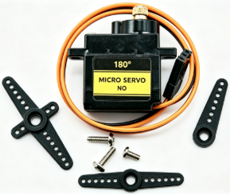
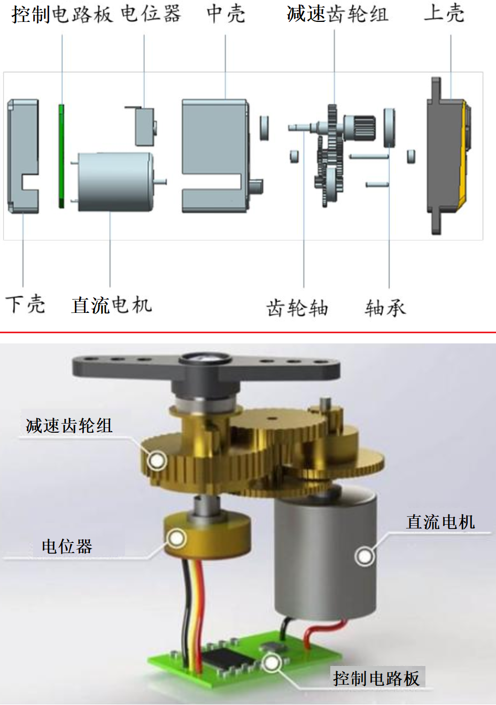
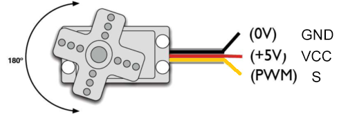
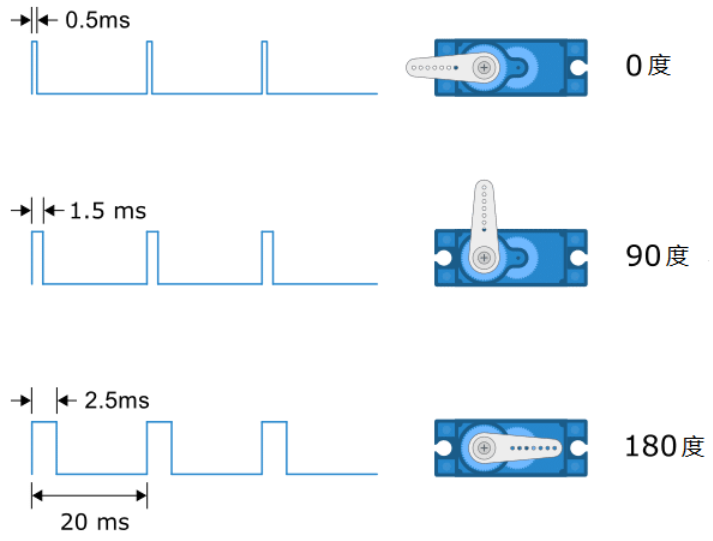
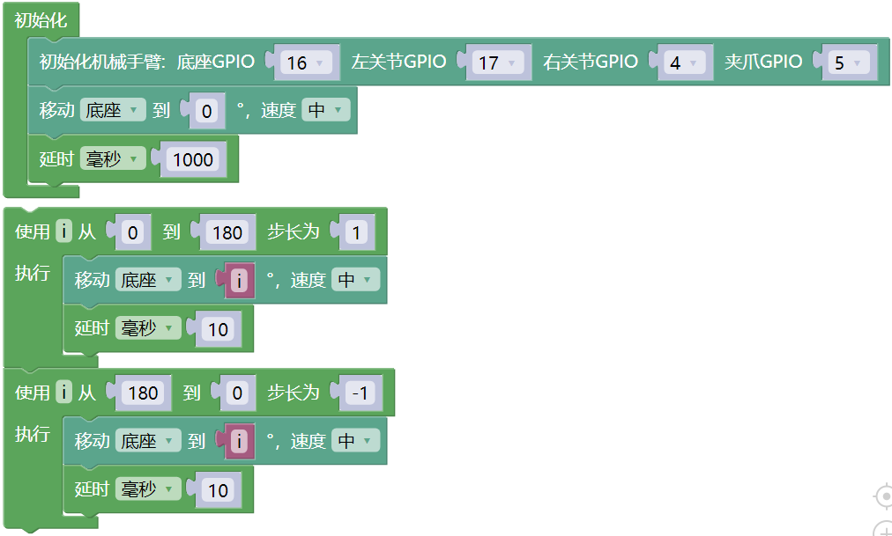
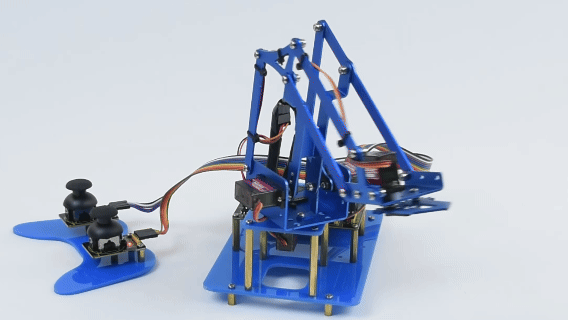

### 第01课 转盘转动  

#### 1.1 项目介绍  

  

在前面的机械手臂组装中，我们已经设置了舵机角度。舵机是一种可以非常精确地旋转的电机。目前已广泛应用于玩具车、遥控直升机、飞机、机器人等领域。

本项目我们将学习控制舵机，使底座舵机（即：整个机械手臂）在 0°~180° 之间来回转动。

#### 1.2 模块相关资料  

舵机是一种位置伺服的驱动器，主要是由外壳、控制电路板、直流电机、减速齿轮组与电位器所构成。其工作原理是由接收机或者单片机发出信号给舵机，其内部有一个基准电路，产生周期为20ms，宽度为1.5ms 的基准信号，将获得的直流偏置电压与电位器的电压比较，获得电压差输出。

**内部结构图：**

- 1\. **外壳**：上壳、下壳，整体塑料壳体，保护内部零件；

- 2\. **电路板（控制电路板）**：接收 PWM 信号，驱动电机，处理位置反馈；

- 3\. **无核心马达（空心杯电机）**：动力源，高响应小惯量电机；

- 4\. **齿轮组（减速齿轮）**：多级减速，放大输出扭矩；

- 5\. **位置检测器（电位器）**：跟随输出转轴，检测实时角度，闭环反馈；

**参数：**

- 工作电压：DC 4.8V 〜 6V

- 尺寸：32.2mm x 12mm x 33.3mm   

- 扭力：2.0kg (4.8v)    

- 速度：0.11s (4.8v)   

- 转动角度：最大 180°

- 脉波宽度范围：500 → 2500 微秒

- 舵机类型：模拟舵机       

- 使用温度：0℃ ~ 55℃      

- 死区设定：5 微秒  

- 结构材质：金属铜齿、空心杯电机、双滚珠轴承

**引脚介绍：**

- 棕线：一个接地的引脚；

- 红线：一个连接到+5V电源的引脚；

- 橙线：信号端的引脚，PWM信号控制。

**舵机控制原理：**

舵机的转动角度是通过调节PWM（脉冲宽度调制）信号的占空比来实现的，标准PWM（脉冲宽度调制）信号的周期固定为20ms（50Hz），理论上脉宽分布应在1ms到2ms 之间，但是，事实上脉宽可由0.5ms 到2.5ms 之间，脉宽和舵机的转角0°～180°相对应。

- **0.5ms** 的高电平通常对应 **0°**；

- **1.5ms** 的高电平通常对应 **90°**（中位）；

- **2.5ms** 的高电平通常对应 **180°**；

**引脚限制：**

- 避免使用以下引脚（有特殊功能）：

  - GPIO0（下载模式）

  - GPIO2（内部上拉）

  - GPIO12（启动时电平敏感）

#### 1.3 接线图 

⚠️ 特别提醒：机械手臂已经组装好了，这里不需要把底座舵机拆下来又重新组装和接线，这里再次提供接线图，是为了方便您编写代码！

在前面的组装步骤中，我们已将底座舵机连接到 IO16 接口。

| 底座舵机 | ESP32舵机驱动板 |
| :----------: | :-------: |
| 黄线 | IO16 |
| 红线 |  5V  |
| 棕线 |  G   |

特别注意：接舵机的时候必须要外接供电，因为驱动舵机的电流要求比较大，开发板的电流远远不够。

#### 1.4 实验代码  

⚠️ **重要提醒：这个实验代码是控制底座舵机在0°~180°来回转动的。**

#### 1.5 代码说明  

- 定义4个舵机的引脚。

- 设置底座舵机的初始角度为0°，延时1秒，使底座舵机转到0°位置。

- 底座舵机从0°每隔10毫秒缓慢转到180°。

- 底座舵机从180°每隔10毫秒缓慢转到0°。

#### 1.6 实验结果  

外接电源，将舵机驱动板上的拨码开关拨到 “ON” 端，上电后。选择好正确的开发板板型（ESP32 Dev Module）和 适当的串口端口（COMxx），然后单击  按钮上传代码至ESP32控制板。

代码上传成功后，就可以看到底座舵机（即：整个机械手臂）在0°到180°之间来回转动。  

#### 1.7 注意事项与常见问题

1\. 供电不足：如果发现舵机抖动、无力或 ESP32主控板 频繁重启，请检查外接电池是否有电，以及接线是否牢固。切勿仅依靠 USB 供电驱动大扭矩舵机。

2\. 角度限制：大多数普通舵机（如 SG90）的物理旋转范围略小于 180°（通常在 0-180° 之间，但两端可能有几度的死区）。如果写入 0° 或 180° 时听到舵机发出“咯咯”的挣扎声，请尝试改为 5° 和 175°。