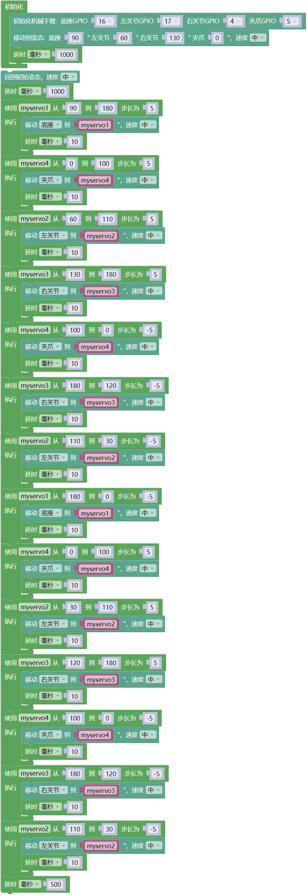
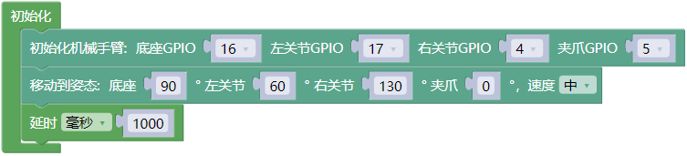
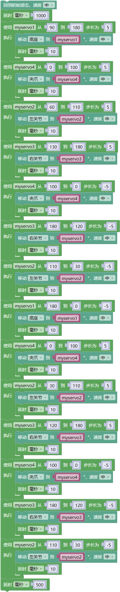
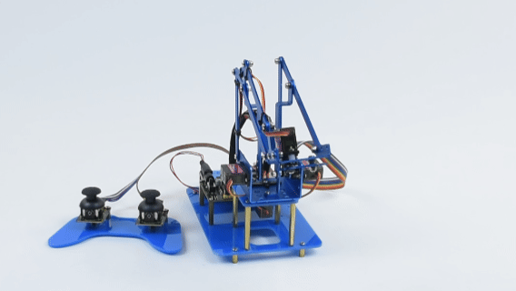

### 第02课 自由伸展  

#### 2.1 项目介绍  

在上一节课中，我们设置了底座舵机（即：整个机械手臂）的来回转动。实际上，我们只需持续改变 4 个舵机的角度，就能让机械手臂完成不同的动作。

#### 2.2 接线图 

⚠️ 特别提醒：机械手臂已经组装好了，这里不需要把4个舵机拆下来又重新组装和接线，这里再次提供接线图，是为了方便您编写代码！

| 左关节舵机 | ESP32舵机驱动板 |
| :----------: | :-------: |
| 黄线 | IO17 |
| 红线 |  5V  |
| 棕线 |  G   |

| 底座舵机 | ESP32舵机驱动板 |
| :----------: | :-------: |
| 黄线 | IO16 |
| 红线 |  5V  |
| 棕线 |  G   |

| 右关节舵机 | ESP32舵机驱动板 |
| :----------: | :-------: |
| 黄线 | IO4 |
| 红线 |  5V |
| 棕线 |  G  |

| 夹爪舵机 | ESP32舵机驱动板 |
| :----------: | :-------: |
| 黄线 | IO5 |
| 红线 |  5V |
| 棕线 |  G  |

特别注意：接舵机的时候必须要外接供电，因为驱动舵机的电流要求比较大，开发板的电流远远不够。

#### 2.3 实验代码  

  

#### 2.4 代码说明  

- 定义4个舵机的引脚。

- 设置开机时4个舵机的初始状态角度。

- 延时1秒。 

- 在重复执行中，每一轮动作开始，先回到初始姿态，消除跳变；

- 机械手臂进行一系列的动作，例如：手臂左右转、夹爪开与合、手臂前伸与后缩、手臂抬起与放下 等。

#### 2.5 实验结果  

外接电源，将舵机驱动板上的拨码开关拨到 “ON” 端，上电后。选择好正确的开发板板型（ESP32 Dev Module）和 适当的串口端口（COMxx），然后单击  按钮上传代码至ESP32控制板。

代码上传成功后，机械手臂将实现循环运动：回到初始姿态、手臂向左转、夹爪打开、手臂抬起、手臂前伸、夹爪闭合、手臂后退、手臂放下；随后手臂向右转、夹爪打开、手臂抬起、手臂前伸、夹爪闭合、手臂后退、手臂放下，持续重复该套动作。
 

