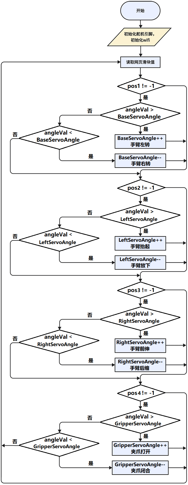
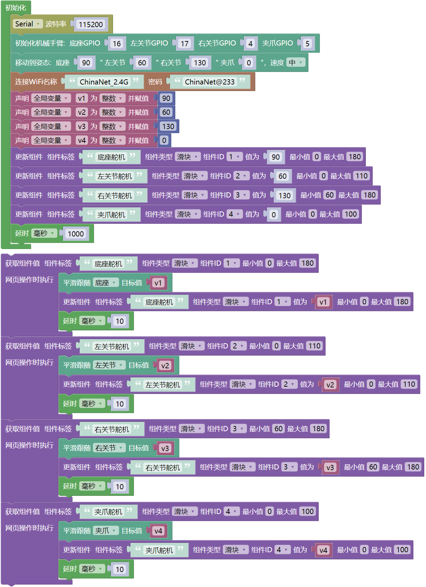
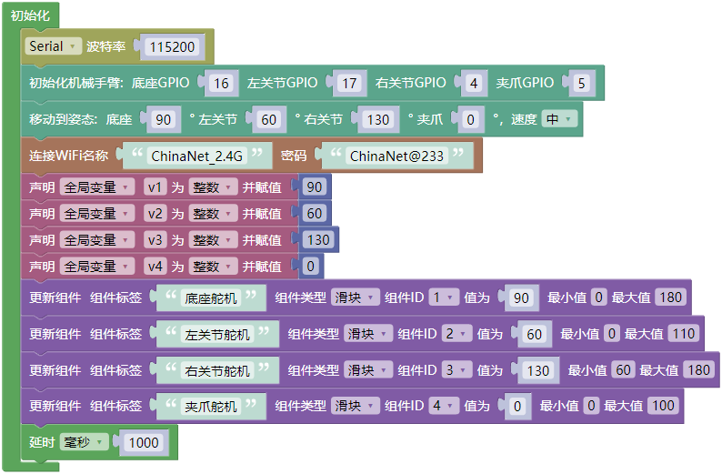
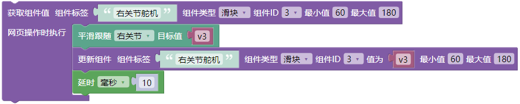
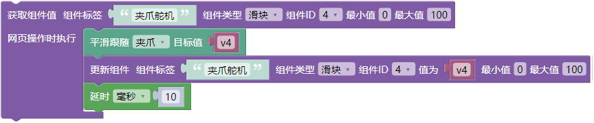
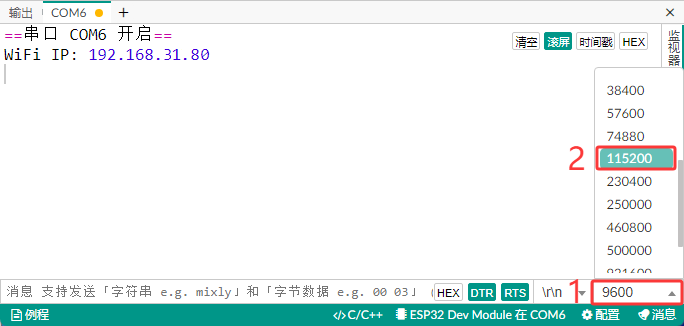
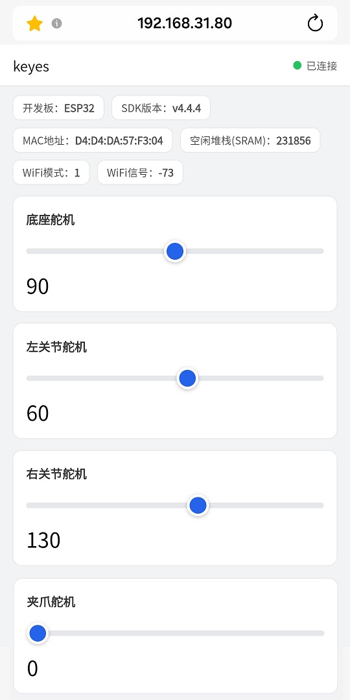
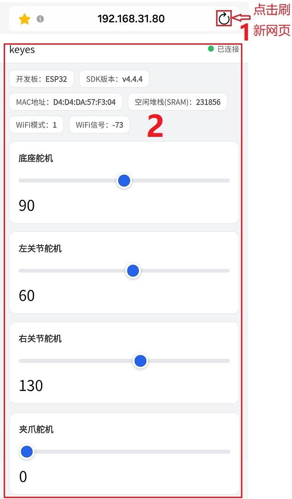
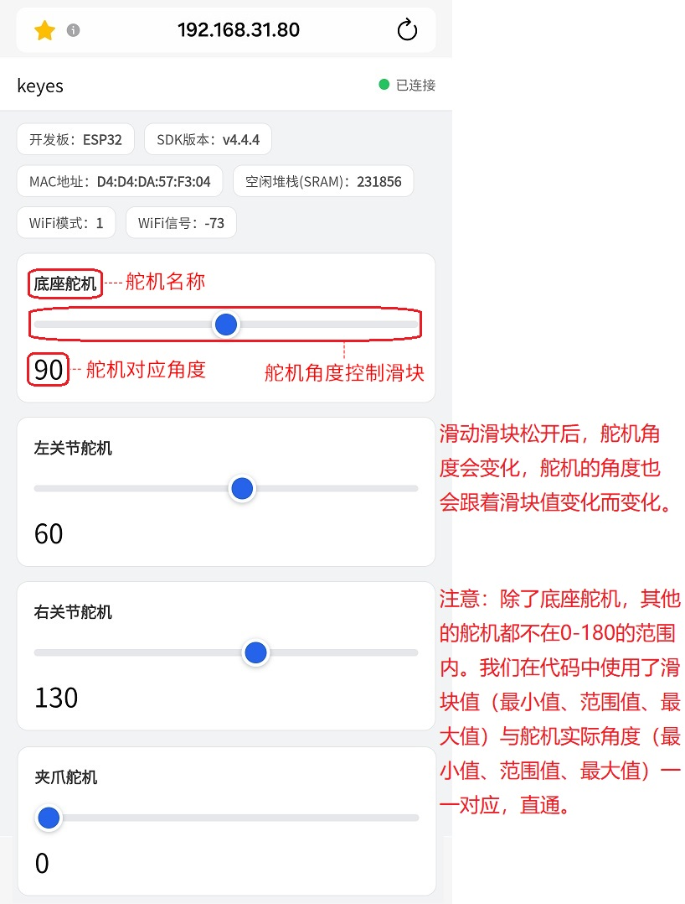
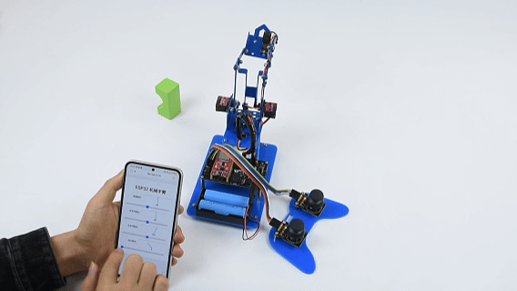

### 第07课 WiFi控制机械手臂  

#### 7.1 项目介绍  

WiFi 机械手臂以 ESP32 作为核心控制器，依托板载 WiFi 功能构建局域网 Web 服务器，实现 **浏览器无线控制机械手臂**。用户使用手机/平板、电脑浏览器访问 IP地址 即可调出可视化控制面板，对机械手臂各关节进行角度调节，完成物体抓取、搬运等操作，无需额外安装控制软件。

#### 7.2 流程图 

#### 7.3 接线图

⚠️ 特别注意：机械手臂已经组装好了，这里不需要把舵机拆下来又重新组装和接线，这里再次提供接线图，是为了方便您编写代码！

| 左关节舵机 | ESP32舵机驱动板 |
| :----------: | :-------: |
| 橙线 | IO17 |
| 红线 |  5V  |
| 棕线 |  G   |

| 底座舵机 | ESP32舵机驱动板 |
| :----------: | :-------: |
| 橙线 | IO16 |
| 红线 |  5V  |
| 棕线 |   G  |

| 右关节舵机 | ESP32舵机驱动板 |
| :----------: | :-------: |
| 橙线 | IO4 |
| 红线 |  5V |
| 棕线 |  G  |

| 夹爪舵机 | ESP32舵机驱动板 |
| :----------: | :-------: |
| 橙线 | IO5 |
| 红线 |  5V |
| 棕线 |  G  |

特别注意：接舵机的时候必须要外接供电，因为驱动舵机的电流要求比较大，开发板的电流远远不够。

#### 7.4 实验代码  

⚠️ **特别提醒：** 打开代码文件后，需要修改ESP32开发板需要连接的WiFi名称与WiFi密码，您需要将 `ChinaNet_2.4G` 和 `ChinaNet@233` 分别替换为您自己的 WiFi名称 和 WiFi密码。WiFi名称和WiFi密码修改后才能上传代码，否则你的ESP32开发板将无法连接网络。

⚠️ **特别注意：** 请确保代码中的WiFi名称和WiFi密码与连接到您的电脑、手机/平板、ESP32开发板和路由器的网络相同，它们必须在同一局域网（WiFi）内。

⚠️ **特别注意：**  WiFi必须是2.4GHz频率的，否则ESP32无法连接WiFi。

#### 7.5 代码说明

**功能：上电初始化**

- 开启串口，初始化机械手臂 4 个舵机引脚（底座 16、左关节 17、右关节 4、夹爪 5），机械臂上电先自动运动到初始姿态：底座 90°、左关节 60°、右关节 130°、夹爪 0°；

- 连接指定 WiFi，连接成功后打印 ESP32 的 IP 地址；

- 定义全局变量 `v1/v2/v3/v4`，分别存储四个舵机的目标角度，初始值和机械手臂姿态匹配；

- 初始化网页 4 个滑块，把滑块初始位置和机械手臂初始角度对齐；

- 延时 1000ms，等待舵机稳定，之后进入网页监听循环。

- 对应手机界面：网页刚打开，滑块默认位置就是 90、60、130、0，和机械手臂上电姿态一致。

**功能：网页拖动【底座舵机】滑块时触发**

- 获取网页滑块传过来的数值，存入目标变量 `v1`；

- 调用内置**平滑跟随**积木，控制底座舵机平缓转到 v1 目标角度（不用自己写 ± 步进逻辑，是封装好的平滑移动）；

- 更新网页底座滑块的值为 v1，同步刷新网页滑块位置；

- 延时 10ms，控制响应节奏。

**功能：网页拖动【左关节舵机】滑块时触发**

- 逻辑和底座完全一致：

- 读取滑块数值存入`v2` → 左关节平滑跟随转到目标角度 → 刷新网页左关节滑块位置 → 延时 10ms。

**功能：网页拖动【右关节舵机】滑块时触发**

- 读取滑块数值存入`v3` → 右关节平滑跟随转到目标角度 → 刷新网页右关节滑块位置 → 延时 10ms。

**功能：网页拖动【夹爪舵机】滑块时触发**

- 读取滑块数值存入`v4` → 夹爪舵机平滑跟随转到目标角度，实现开合 → 刷新网页夹爪滑块位置 → 延时 10ms。

#### 7.6 实验结果  

⚠️ 特别注意：手机/平板（**安卓系统或苹果系统**）和电脑一定要与ESP32开发板连接的是同一个WiFi，否则将无法进入控制页面，还有就是ESP32开发板在使用WiFi功能时功耗很大需要外接直流电源才能满足它的工作电力需求，如果达不到它的工作电力需求ESP32主控板将会一直复位导致代码无法正常运行。

外接电源，将舵机驱动板上的拨码开关拨到 “ON” 端，上电后。选择好正确的开发板板型（ESP32 Dev Module）和 适当的串口端口（COMxx），然后单击  按钮上传代码至ESP32控制板。

代码上传成功后，单击Mixly IDE右下角串口监视器窗口的，设置波特率为115200，串口监视器窗口会打印连接成功后的IP地址。(注意：如果看不到，可以按下ESP32主控板上的复位按键重新连接一次) 

打开手机/平板（**安卓系统或苹果系统**）浏览器，在网址框中输入IP地址，如示例中的是 “**192.168.31.80**”，然后就能进入网页如图：

⚠️ **特别提醒：在浏览器的网址框中输入ESP32的IP地址，然后访问网页，进入对应页面，如果页面显示是空白，如下图所示，那么需要点击  ，刷新页面即可。**

**控制页面讲解：**

移动滑块可以达到控制舵机旋转的效果，完成机械手臂对物体抓取、搬运等操作。

 
 

