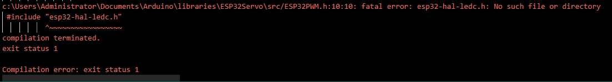
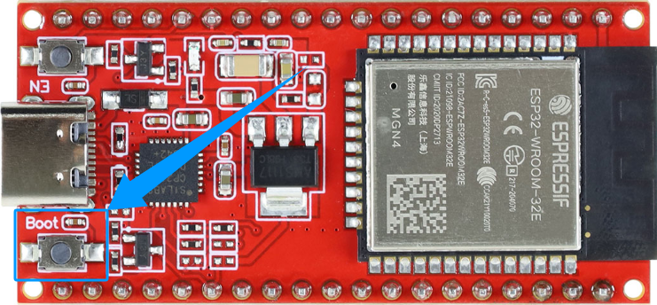
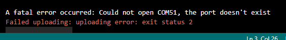
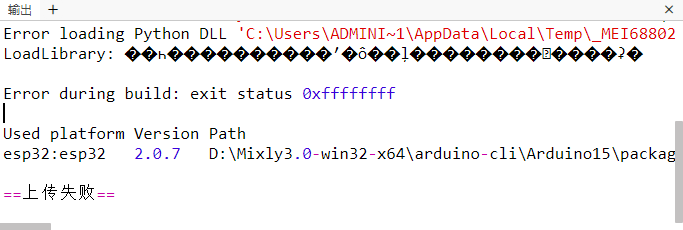
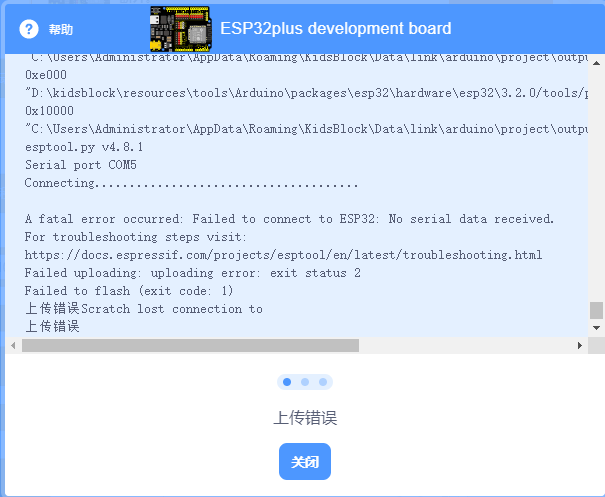
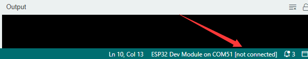
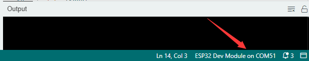

# 7. 常见故障排除

### 问：Arduino IDE 报错

1\. 如果报错项如下图，则是没有安装 `ESP32Servo` 库文件，安装好 `ESP32Servo` 库文件便能解决（注意：需要添加ESP32Servo库文件）

2\. 如果报错项如下图，可能是没有选择开发板或者你选错了开发板或者你没有添加ESP32Servo库文件，应该在上传时选择`ESP32 Dev Module`。

3\. 如果上传时出现了“— —…..— —…..— —….”然后就退出上传模块并报错上传失败，则是需要点击IDE的上传键后按ESP32开发板上的`Boot`按钮。

4\. 如果报错项如下图，则是你没有选择开发板的COM口或者是选错了COM口，选择正确的COM口即可解决这个问题，如果你不确定哪个是正确的，可以将开发板的USB线拔了看哪个COM口消失了，然在插上USB又出现了这样去确定正确的COM口。

5\. 如果出现Arduino IDE / kidsblock IDE / Mixly IDE的COM口一下断开一下连接，这是因为电脑USB口的电流不能满足机械手臂的工作需求，导致ESP32无法正常工作，这个问题我们只需要接上外接DC电源即可解决（注意要将开关拨到ON），右下角可以看到COM口的状态图下图：

### 问：控制机械手臂的舵机不动

答：

1. 安装舵机时是否有按照教程设置舵机角度，如果没有则拆了设置好角度在装好;

2. 检查外接电源电量是否充足。

### 问：遥杆的值最高达不到4095

答：没有外接电源或者外接电源的电量已经消耗完了，外接电源电压范围7-12V

### 问：WiFi一直连接不上？

答：

1. 请将ESP32移动到路由器周边，重启ESP32，耐心等待连接即可。

2. 若还是一直连接不上，请查看WiFi名称和密码是否填写正确。

3. 若还是连不上，则看一下你的wifi的频率是多少，esp32只能连接2.4GHz频率的wifi。

------

### 问：网页端远程操作其他传感器时，反应很慢？

答：路由器网络传输变慢的原因：

- 多人连接，路由器CPU资源不足，重启路由器，重新连接。

- 路由器系统使用时间过长，重启路由器。

- 无线干扰，无线信号不稳定时，请勿穿墙使用。

路由器相关知识，请自行**google**搜索。  

